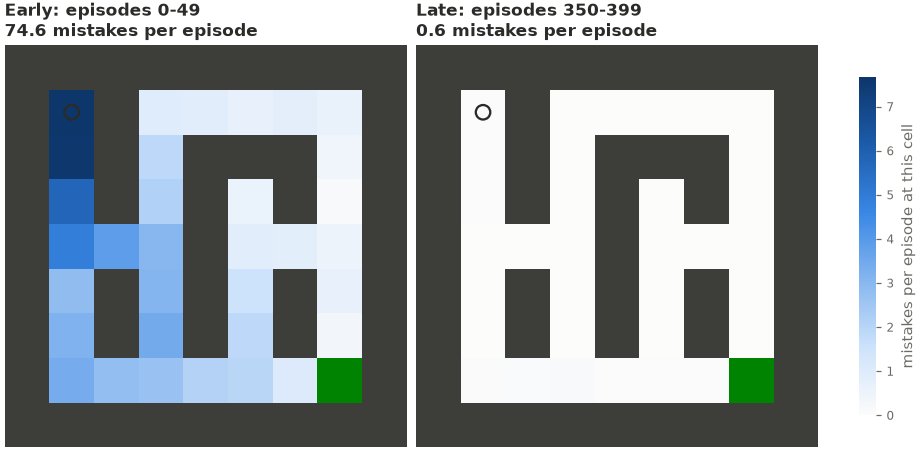
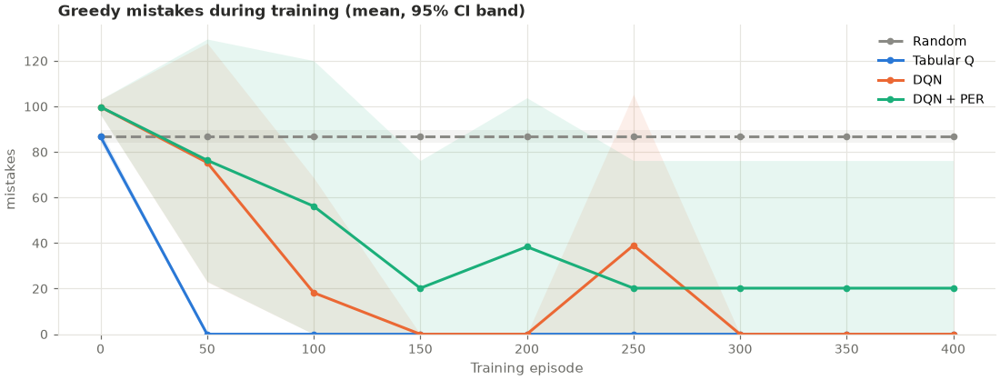
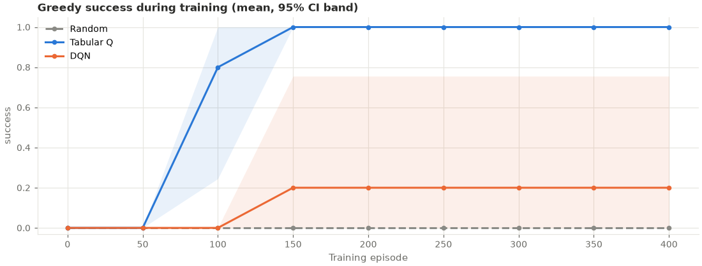
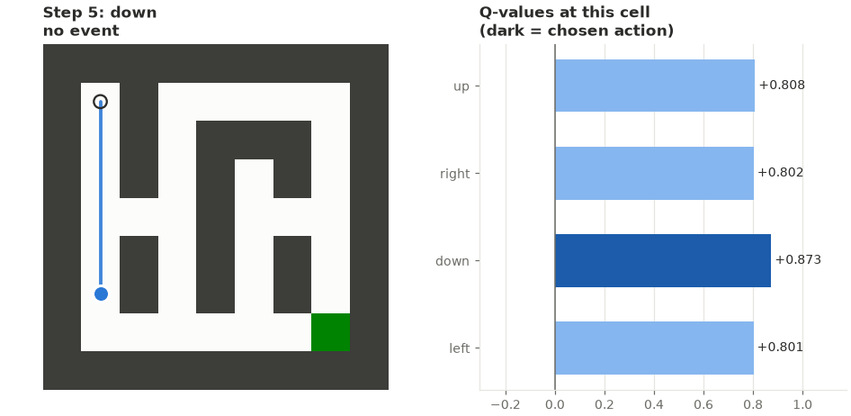

# MIND: an AI that learns from its own mistakes

[](https://colab.research.google.com/github/anusidhu9/ai-that-learns-from-its-mistakes/blob/main/MIND_Colab.ipynb)

Reinforcement-learning agents explore grid worlds, get **rewarded** for reaching the goal and **penalised** for mistakes (hitting walls, stepping on hazards, revisiting cells, running out of time), and are then tested to see whether they actually got better. Everything runs on a free CPU: Google Colab or a laptop.

The project compares a random baseline, tabular Q-learning, a Deep Q-Network (DQN) and DQN with prioritized experience replay across five experiments, 3–5 seeds each, with greedy evaluation, 95% confidence intervals and permutation tests. It includes an interactive **Gradio dashboard** and a mildly sarcastic commentator.



*Tabular Q-learning on the fixed maze (one seed). In its first 50 episodes the agent made 74.6 mistakes per episode, concentrated in the dead-end corridor below the start. By the last 50 it made 0.6.*

## Results at a glance

All numbers are **greedy** (exploration off), averaged across seeds, ± a 95% confidence interval. The full analysis is in [REPORT.md](REPORT.md).

| Experiment | Random | Tabular Q | DQN | DQN + PER |
|---|---|---|---|---|
| `fixed_maze`: one 9×9 maze, 5 seeds | 0.06 ± 0.07 | **1.00** ± 0.00 | **1.00** ± 0.00 | 0.80 ± 0.56 |
| `hazard_maze`: 4 hazards (−0.5 each) | 0.12 ± 0.06 | **1.00** ± 0.00 | **1.00** ± 0.00 | **1.00** ± 0.00 |
| `terminal_hazards`: a hazard ends the episode | 0.00 ± 0.00 | **1.00** ± 0.00 | 0.20 ± 0.56 | — |
| `open_hazards`: 8×8 open grid, 5 hazards | 0.40 ± 0.23 | **1.00** ± 0.00 | **1.00** ± 0.00 | **1.00** ± 0.00 |
| `generalization`: **unseen** mazes, 3 seeds | 0.07 ± 0.03 | 0.29 ± 0.06 | 0.45 ± 0.15 | — |

*Success rate (fraction of greedy episodes that reach the goal).*

**What the evidence supports**
- **The agents learn from their mistakes.** Tabular Q-learning and DQN beat random on every fixed layout (permutation test p = 0.008, the smallest possible with 5 seeds per agent). On `fixed_maze` and `open_hazards` both take the shortest path with zero mistakes in every seed; on `hazard_maze` both always reach the goal, though sometimes through a hazard (below).
- **Mistake counts alone can lie.** When hazards end the episode, DQN learned to walk into one in 4 of 5 seeds: dying quickly (−0.51) was cheaper than wandering for 100 steps (about −3.6). Its mistake count looked better than random's while its success rate was 0.20 (vs 1.00 for tabular Q, p = 0.048).
- **Prioritized replay did not help** on these small tasks.

**What it does not (yet) support**
- On unseen mazes DQN was ahead of tabular Q on every seed (0.40–0.52 vs 0.26–0.30), but with 3 seeds the smallest possible p-value is 0.10. More seeds are needed before claiming it generalizes better.
- On the hazard maze, tabular Q took a route through a hazard in 4/5 seeds and DQN in 1/5; p = 0.21, so this is not established either.

| Learning to avoid mistakes (fixed maze) | When fewer mistakes is not better (terminal hazards) |
|---|---|
|  |  |

## Quick start

**In Colab (no setup):** click the badge above, then *Runtime → Run all*. The notebook clones this repository, runs the tests, trains all agents, shows the results and launches the dashboard with a public link.

**Locally (Python 3.10+):**

```bash
git clone https://github.com/anusidhu9/ai-that-learns-from-its-mistakes.git
cd ai-that-learns-from-its-mistakes
python -m venv .venv
# Windows: .venv\Scripts\activate    macOS/Linux: source .venv/bin/activate
pip install -r requirements.txt
python -m pytest -q -m "not slow"     # ~45 s
python -m src.app                     # dashboard at http://127.0.0.1:7860
```

For a CPU-only PyTorch (smaller download), install it first with `pip install torch --index-url https://download.pytorch.org/whl/cpu`.

## The dashboard

`python -m src.app` (add `--share` for a temporary public link, e.g. from Colab).

| Tab | What it does |
|---|---|
| 📊 Results | Every saved experiment: bar charts and greedy learning curves with 95% CIs, tables, permutation tests with verdicts |
| 🏋️ Train | Train any agent on any environment with live learning curves, commentary and achievements |
| 🔥 Mistake history | Early-vs-late mistake heatmap, reward breakdown, the Hall of Shame, the full mistake log |
| 🎬 Watch it play | Record a greedy episode and replay it step by step with the agent's Q-values, on the training layout or an unseen one |
| ⚔️ Q-learning vs DQN | Train both live on the same environment and seed |
| ✅ Evaluate | Greedy evaluation on the training layout and on unseen layouts |
| 💾 Checkpoints | Download the trained agent, or upload a checkpoint (loaded in PyTorch's safe mode) |



## Command line

```bash
python -m src.envs                                            # show the four environments
python -m src.training --agent dqn --episodes 400 --run-dir runs/dqn_s0
python -m src.training --resume runs/dqn_s0                   # continue after a disconnect
python -m src.training --resume runs/dqn_s0 --episodes 800    # extend a finished run
python -m src.evaluation --experiment fixed_maze              # a full multi-seed experiment
python -m src.evaluation --experiment fixed_maze --seeds 2 --agents random tabular_q   # quick version
python -m src.visualization                                   # regenerate docs/figures from results/
```

Experiments are **resumable**: if Colab disconnects, run the same command again and finished runs are skipped while interrupted ones continue from their last checkpoint. On a laptop CPU the four fixed-layout experiments take roughly 10–30 minutes each (DQN dominates the time); `generalization`, with 3,000 episodes per run, takes considerably longer.

## How it works

**Environments** (`src/envs.py`). A grid with walls, optional hazards and a goal; actions are up/right/down/left. All four presets (`maze`, `maze_hazards`, `open`, `open_hazards`) produce the same flat observation vector, so every algorithm sees exactly the same information: either the full map (`grid` mode) or a 5×5 window around the agent plus the direction to the goal (`local` mode). Every generated layout is guaranteed to have a hazard-free path to the goal, and layouts are reproducible from a seed, which makes held-out "unseen" layouts possible.

| Event | Reward |
|---|---|
| each step | −0.01 |
| reach the goal | +1.0 (ends the episode) |
| walk into a wall (agent stays put) | −0.05 |
| step on a hazard | −0.5 |
| revisit a cell in the same episode | −0.02 |
| run out of steps (100) | −0.1 (ends the episode) |

**Agents** (`src/agents.py`, `src/replay.py`)
- **Random**: the baseline.
- **Tabular Q-learning**: `Q(s,a) ← Q(s,a) + α [r + γ max Q(s′,·) − Q(s,a)]`, with α = 0.5, γ = 0.99. The term in brackets, the TD error, is how far the prediction was from what happened: each penalty becomes a negative TD error that lowers the value of the action that caused it.
- **DQN**: a 2×128 MLP minimising the Huber loss to `r + γ Q_target(s′, argmax Q(s′,·))` (Double DQN), with a target network copied every 100 updates and experience replay.
- **DQN + PER**: replays transitions with probability ∝ |TD error|^0.6, corrected by importance-sampling weights.

Exploration is ε-greedy, decaying linearly from 1.0 to 0.05. Timeouts are treated as truncation (the agent still bootstraps), not as true terminal states.

**Learning from mistakes** (`src/training.py`). Every episode logs its collisions, hazards, revisits, timeouts and where the reward came from; every mistake is logged with its step, cell and action. `mistake_hotspots` finds the agent's recurring failures, and `compare_phases` compares early and late training. Checkpoints include the replay buffer and every random-number-generator state, so a resumed run reproduces an uninterrupted one exactly (tested).

**Evaluation** (`src/evaluation.py`). Agents are evaluated greedily with exploration off, without changing them, on training layouts and on unseen ones. Results are reported as the mean across seeds with a t-based 95% confidence interval, and pairs of agents are compared with an exact permutation test.

**The lighter side** (`src/fun.py`). Agents have nicknames (Chaos Monkey, The Spreadsheet, Neural Ned, Neural Ned (Holds Grudges)), every mistake gets commentary, there are seven achievements, and the Hall of Shame lists the agent's most repeated mistakes:

```
HALL OF SHAME
  #1 Favourite Wall to Hug    collision at (1, 1)  x505
  #2 Wall of Fame             collision at (2, 1)  x345
  #3 Most Visited Landmark    revisit   at (4, 1)  x310
```

The commentator only reads the logs; it never changes a reward, an agent or a result, and its verdicts only declare a winner when p < 0.05.

## Project structure

```
src/
  envs.py           grid worlds, rewards, mistake events
  agents.py         random, tabular Q-learning, DQN (+ Double DQN), agent factory
  replay.py         uniform and prioritized replay buffers (sum tree)
  training.py       Trainer: logs, checkpoints, exact resumption, CLI
  evaluation.py     greedy evaluation, multi-seed experiments, statistics, CLI
  visualization.py  every chart, episode replays, report figures
  fun.py            commentary, nicknames, achievements, Hall of Shame
  app.py            Gradio dashboard
tests/              150 tests (pytest); `-m "not slow"` skips one long training test
results/            saved experiment results (summaries, per-run metrics, curves, logs)
docs/figures/       figures used here and in the report
MIND_Colab.ipynb    end-to-end notebook
REPORT.md           final report
CHANGELOG.md        what changed at each stage, and why
LICENSE             MIT License
```

## Limitations

- Small grids (8×8 and 9×9) and short training budgets chosen for a free CPU; results may not hold for larger tasks.
- 3–5 seeds per experiment: enough to show large differences, not small ones.
- One set of hyperparameters per algorithm, tuned on the fixed maze only.
- The revisit penalty depends on history the observation does not include, so that part of the reward is not Markovian.

See [REPORT.md](REPORT.md) for the full discussion.

## License

Released under the [MIT License](LICENSE).
