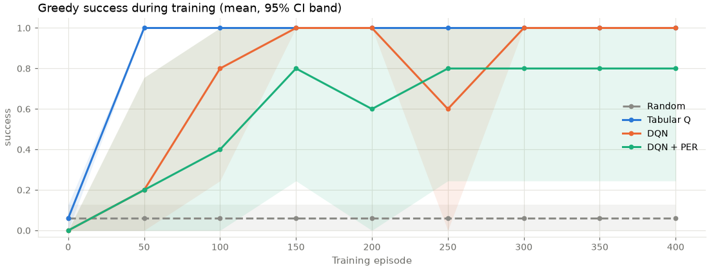
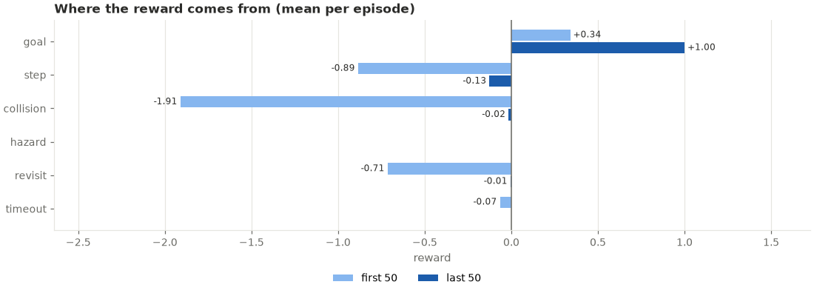
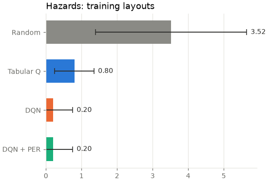
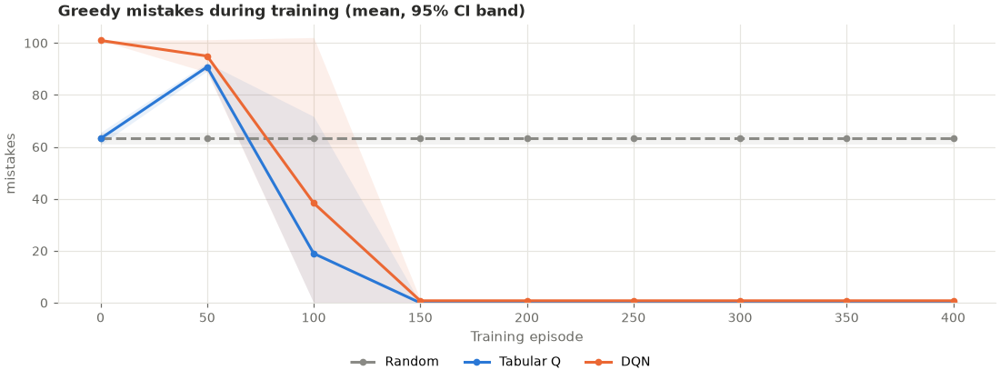
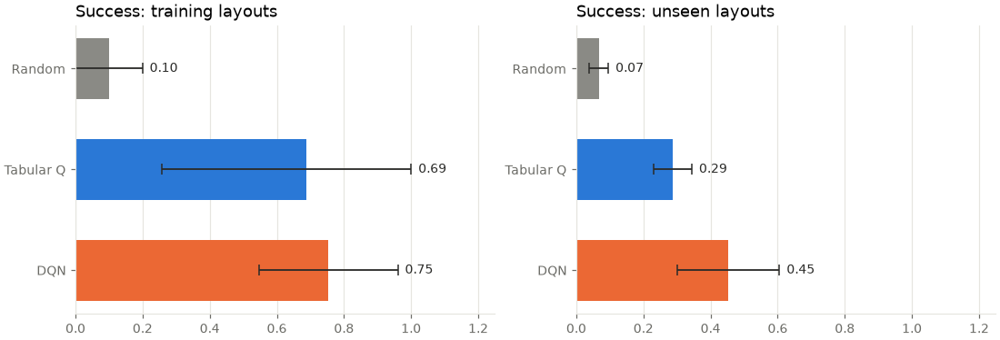
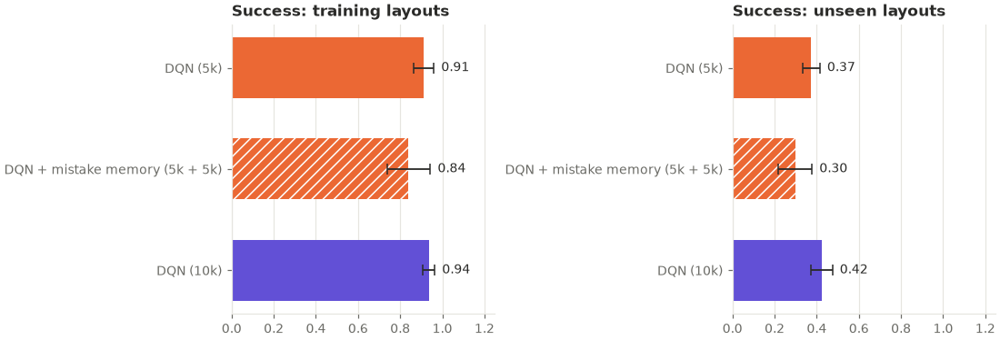
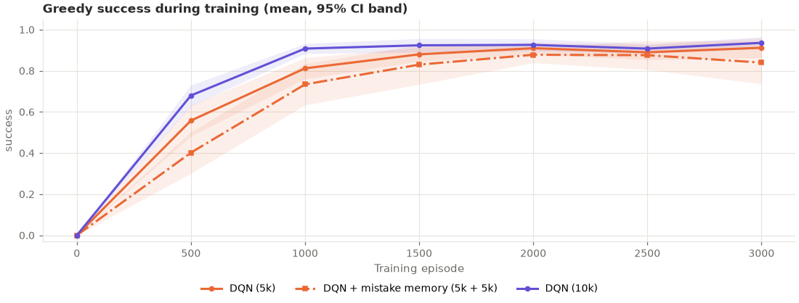
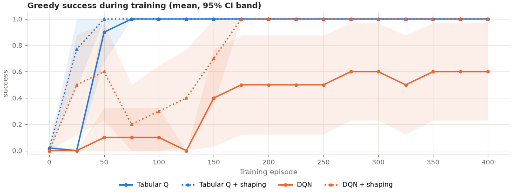
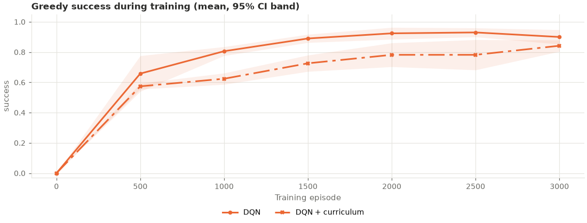
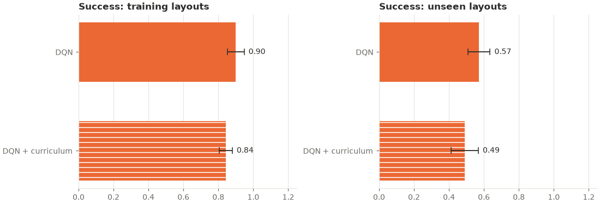

# MIND: an AI that learns from its own mistakes — final report

## 1. Summary

This project trains reinforcement-learning agents in grid worlds where they are rewarded for reaching a goal and penalised for mistakes (wall collisions, hazards, revisiting cells, timeouts), then tests whether they really make fewer mistakes. Four agents (a random baseline, tabular Q-learning, a Deep Q-Network and DQN with prioritized experience replay) were compared in five experiments with 5–10 independent seeds each, DQN with an explicit memory of its mistakes was tested in two more, potential-based reward shaping in two pre-registered experiments, dueling heads and 3-step returns for DQN in two more, and an easiest-first training curriculum in one more, using greedy evaluation (exploration off), 95% confidence intervals and exact permutation tests.

Main findings:

1. **Both learning agents learned from their mistakes on every fixed layout.** Greedy success rose from 0.00–0.40 before training to 1.00 for tabular Q-learning in all three fixed-layout experiments with non-terminal hazards, and to 0.90–1.00 for DQN (p ≤ 0.008 against random in every case).
2. **Fewer mistakes is not the same as better behaviour.** When stepping on a hazard ended the episode, DQN learned in 4 of 5 seeds to walk into the nearest hazard after 6 steps. Under the reward design, a quick death (−0.51) cost less than an unsuccessful 100-step search (about −3.6). Its mistake count fell to 0.8 per episode while its success rate was 0.20, against 1.00 for tabular Q-learning (p = 0.048).
3. **DQN generalizes better to unseen mazes.** Trained on 50 mazes and tested on 50 it had never seen, DQN reached the goal 45% of the time against 34% for tabular Q-learning and 6% for random (10 seeds; DQN vs tabular p = 0.003, ahead in 9 of 10 seeds). DQN's successes on new mazes were near-shortest paths, while tabular Q's were mostly long wanders (path efficiency 0.45 vs 0.15, p < 0.001). On the training mazes the two were level.
4. **DQN avoids hazards that tabular Q-learning walks through, but is less reliable.** With 10 seeds on the hazard maze, tabular Q-learning took a shortcut through a hazard in 9 runs and DQN in 1 (p = 0.002). One DQN run, however, solved the maze and then unlearned it before training ended, something no tabular run did.
5. **Prioritized experience replay gave no measurable benefit** on these tasks; one of its five fixed-maze runs never solved its maze.
6. **Replaying mistakes explicitly gave no measurable benefit either.** Keeping collision and hazard transitions in a reserve and drawing 25% of every batch from it did not improve DQN on the hazard maze (Section 6.6). It also did not help in a pre-registered study on held-out hazard mazes, where a small buffer forced the reserve to be the only memory of most past mistakes (0.30 vs 0.37 held-out success, p = 0.082; Section 6.7). A DQN given the same total memory for ordinary experience did best.
7. **A hint toward the goal speeds up learning, but did not measurably improve generalization.** Potential-based reward shaping (strength fixed at 1.0 in advance) made both agents learn a fresh maze sooner (pre-registered, Holm-corrected: tabular Q p = 0.002, DQN p = 0.002). Shaped DQN solved the maze in all 10 seeds, plain DQN in 6. On 50 held-out mazes, shaped DQN reached the goal in 54% against 48% (p = 0.366): no evidence of a difference (Section 6.8).
8. **3-step returns made DQN learn a maze much faster; dueling heads made no measurable difference; neither improved generalization.** On a fresh maze, 3-step DQN's learning speed was 0.863 against 0.369 (pre-registered, Holm-corrected p = 0.0003, ahead in all 10 seeds); dueling DQN's was 0.338 (p = 0.82). On 50 held-out mazes both variants were +0.03 ahead of plain DQN, far from significant (Holm-corrected p = 0.93; Section 6.9).
9. **Training on easy mazes first made DQN learn more slowly.** With the same 50 training mazes in easiest-first order, DQN's learning speed was 0.722 against 0.851 for uniform order (pre-registered, Holm-corrected p = 0.0003, behind in all 10 seeds). On 50 held-out mazes it reached the goal in 49% against 57% (behind in 8 of 10 seeds, p = 0.093): no evidence of a difference (Section 6.10).

## 2. Question and approach

*Does an agent that is penalised for its mistakes measurably stop making them, and how should that be measured?*

The project was built in stages, each with tests: environments (Stage 1), a random baseline and tabular Q-learning (2), DQN with replay (3), persistent logs, checkpoints and exact resumption (4), multi-seed evaluation (5), visualization and an interactive dashboard (6–7). The project rule throughout was that no improvement is claimed unless the experiments support it.

## 3. Environments

A `GridWorld` holds walls, optional hazards, a start and a goal. Actions are up, right, down and left; moving into a wall leaves the agent in place. Episodes end at the goal, on a hazard if hazards are terminal, or after 100 steps (a truncation, not a true terminal state).

| Event | Reward |
|---|---|
| each step | −0.01 |
| reach the goal | +1.0 |
| walk into a wall | −0.05 |
| step on a hazard | −0.5 |
| revisit a cell in the same episode | −0.02 |
| timeout after 100 steps | −0.1 |

Penalties are added to the step cost. An episode's mistakes are its collisions + hazards + revisits + timeouts.

**Optional reward shaping** (off unless stated). The agent learns from the task reward plus F = k · (γ·φ(s′) − φ(s)), where φ(s) is minus the maze distance from the agent's cell to the goal, divided by the largest such distance in the layout (so φ is in [−1, 0]), and φ = 0 once the episode terminates. With γ = 0.99, the agents' own discount, this potential-based form leaves the optimal policy unchanged (Ng, Harada & Russell, 1999), and the discounted shaping over any episode telescopes to γ^T·φ(s_T) − φ(s_0), so walking in circles earns nothing. Shaping is logged separately; every reported reward is the task reward.

| Preset | Layout | Hazards |
|---|---|---|
| `maze` | 9×9 maze from a randomized depth-first search, 10% of removable walls removed to create loops; start top-left, goal bottom-right | none |
| `maze_hazards` | 9×9 maze, 30% loops | 4, non-terminal |
| `open` | 8×8 grid, 10% random walls, random start and goal | none |
| `open_hazards` | as `open` | 5, non-terminal |

Every layout is generated deterministically from a seed and is guaranteed to have a hazard-free path to the goal. The length of that path (by breadth-first search) is the **optimal length** used for path efficiency.

**Observations.** All agents receive the same flat float32 vector. In `grid` mode it is four one-hot planes (walls, hazards, goal, agent) over the whole map; on a fixed layout this makes the state equivalent to the agent's position. In `local` mode it is a 5×5 window around the agent (walls, hazards, goal; out of bounds counts as wall) plus the normalised direction to the goal, which does not depend on absolute position and so can transfer between layouts. The revisit penalty depends on the agent's history, which neither mode contains, so that component of the reward is not Markovian; including the visited set would have made the tabular state space intractable.

## 4. Agents

**Random.** Uniform random actions; never learns.

**Tabular Q-learning.** A dictionary maps each observation to four action values, updated after every step:

```
target  = r                               if s' is terminal
        = r + γ · max_a' Q(s', a')        otherwise (including timeouts)
Q(s,a) ← Q(s,a) + α · (target − Q(s,a))
```

The quantity `target − Q(s,a)` is the temporal-difference (TD) error: how wrong the agent's prediction was. A penalty produces a negative TD error that lowers the value of the action that caused it, which is the precise sense in which the agent learns from a mistake. Unvisited states start at Q = 0. Because every reward except the goal is negative, zero is optimistic, which drives systematic exploration.

**DQN** (Mnih et al., 2015). A multilayer perceptron (two hidden layers of 128 ReLU units) replaces the table. Each gradient step samples a batch of 64 past transitions and minimises

```
L(θ) = mean_i  w_i · Huber( y_i − Q(s_i, a_i; θ) )
y_i  = r_i + γ · Q(s'_i, argmax_a Q(s'_i, a; θ); θ⁻)     (Double DQN; y_i = r_i if terminal)
```

where θ⁻ is a target network copied from θ every 100 gradient steps. Experience replay (a 20,000-transition buffer) breaks the correlation between consecutive steps and lets each mistake be learned from repeatedly.

**DQN + PER** (Schaul et al., 2016). Transition *i* is replayed with probability `P(i) = p_i^α / Σ p_k^α`, where `p_i = |TD error_i| + 0.001` and α = 0.6, so the most surprising experiences are replayed most. The resulting bias is corrected with importance weights `w_i = (N·P(i))^(−β) / max w`, with β annealed from 0.4 to 1. Sampling uses a sum tree (O(log N)).

**Exploration.** ε-greedy, decaying linearly from 1.0 to 0.05 (over 300 episodes in the fixed-layout experiments, 2,000 in the generalization experiment). Greedy actions break ties randomly.

| Hyperparameter | Tabular Q | DQN / DQN + PER |
|---|---|---|
| discount γ | 0.99 | 0.99 |
| learning rate | α = 0.5 | Adam, 1e-3 |
| batch size / buffer | — | 64 / 20,000 |
| learning starts after | — | 500 steps |
| gradient step every | every step | 2 env steps |
| target network update | — | every 100 gradient steps |
| loss / gradient clip | — | Huber / norm 10 |
| PER α, β | — | 0.6, 0.4 → 1 over 20,000 updates |

DQN's `train_freq` and `target_update` were tuned on the fixed maze during development (Section 8). No other tuning was done.

**DQN + mistake memory** (`dqn_mistake`; `dqn_per_mistake` combines it with PER). A step counts as a mistake when the environment reports a `collision` or `hazard` event for it. The label comes from the event, not the reward, because a revisit plus a timeout costs more than a wall bump and reward values are configurable. Every transition still goes into the normal buffer. Mistakes are also copied into a separate circular reserve of 5,000 transitions, and each batch of 64 takes `min(round(0.25 · 64), len(reserve))` transitions uniformly from the reserve and the rest from the normal buffer. This deliberately over-weights mistakes and is not corrected by importance weights; reserve samples get weight 1 and never change PER priorities. The fraction (0.25) and reserve size (5,000) were fixed before any experiment and not tuned. The option is off by default; with it off, DQN and DQN + PER reproduce their earlier results exactly (checked by training fingerprints and by rerunning `hazard_maze`).

**Dueling DQN** (`dqn_dueling`; Wang et al., 2016). The last layer is replaced by two heads on the same hidden layers: a state value V(s) and per-action advantages A(s, a), combined as `Q(s, a) = V(s) + A(s, a) − mean_a′ A(s, a′)`.

**n-step DQN** (`dqn_nstep`, n = 3; as in Rainbow, Hessel et al., 2018). Each stored transition carries `R = r_t + γ r_{t+1} + γ² r_{t+2}` and bootstraps from the state three steps later with γ³. The last one or two transitions of an episode span fewer steps and are stored with γ¹ or γ²; after a timeout they still bootstrap. The rewards include exploratory moves and are not corrected for them. `dqn_dueling_nstep` combines both. Both options are off by default, and with them off DQN and DQN + PER reproduce earlier results exactly (checked by rerunning `hazard_maze`, seeds 0–1). n-step returns are not combined with mistake memory.

## 5. Evaluation protocol

- **Greedy evaluation.** Every reported result is measured with exploration switched off, using a separate environment and a separately seeded tie-breaking generator that is restored afterwards, so evaluation never changes training (tested).
- **When.** Before training (episode 0), every 50 episodes (every 500 for generalization), and at the end.
- **What.** On a fixed layout, 10 greedy episodes; with a layout pool, one episode on each of the 50 training layouts; for generalization, also one episode on each of 50 held-out layouts (seeds 1000–1049) never used in training.
- **Metrics.** Success rate; path efficiency (optimal length ÷ steps, for successful episodes that touched no hazard, otherwise 0); steps; mistakes by type; total reward. The two mistake-replay experiments also report steps to goal (mean steps of successful episodes only, so failures do not count as 100) and hazard rate (share of episodes that touched a hazard).
- **Statistics.** Each seed contributes one value. Results are the mean across seeds ± the half-width of a 95% Student-t confidence interval. Two agents are compared with an exact two-sided permutation test on the per-seed values. With 10 seeds per agent the smallest attainable p-value is about 0.00001, with 5 seeds 2/252 ≈ 0.008, and with 3 seeds 0.10.
- **Seeds.** 10 per agent for `hazard_maze` and `generalization` (both first run with fewer seeds, 5 and 3, then extended to settle open questions; Sections 6.2 and 6.5), 5 for the other fixed-layout experiments. `mistakes_hazard_maze` reuses `hazard_maze`'s seeds 0–9; `long_memory_mistakes` uses fresh seeds 100–109 and fresh layouts, fixed in a written protocol before it ran.

## 6. Results

### 6.1 Fixed maze (`fixed_maze`, 5 seeds, 400 episodes)

| Agent | Success | Path efficiency | Steps | Mistakes |
|---|---|---|---|---|
| Random | 0.06 ± 0.07 | 0.01 ± 0.01 | 97.6 ± 3.1 | 86.8 ± 2.7 |
| Tabular Q | **1.00 ± 0.00** | **1.00 ± 0.00** | 12.0 ± 0.0 | **0.0 ± 0.0** |
| DQN | **1.00 ± 0.00** | **1.00 ± 0.00** | 12.0 ± 0.0 | **0.0 ± 0.0** |
| DQN + PER | 0.80 ± 0.56 | 0.80 ± 0.56 | 29.6 ± 48.9 | 20.2 ± 56.1 |

Tabular Q-learning and DQN found the 12-step shortest path with no mistakes in all five seeds (each p = 0.008 against random). Tabular Q-learning was greedy-perfect by episode 50 in every seed; DQN needed 150 episodes and was less stable, dipping to 0.6 mean greedy success at episode 250 before recovering. DQN + PER succeeded in four seeds; in the fifth its final greedy policy walked into the same wall on all 100 steps.



Before training, tabular Q-learning behaved exactly like the random agent (all Q-values equal, ties broken randomly), whereas the untrained DQN scored 0: its network has no ties, so its greedy policy repeats the same moves.

**Where the mistakes went.** In a single 400-episode tabular run (seed 0), mistakes fell from 74.6 per episode in episodes 0–49 to 0.6 in episodes 350–399. Early mistakes were concentrated in the dead-end corridor below the start; the most repeated were walking into the wall at the start cell and revisiting the corridor cells. Collision and revisit penalties accounted for most of the lost reward early on and almost none at the end:



### 6.2 Maze with non-terminal hazards (`hazard_maze`, 10 seeds)

| Agent | Success | Path efficiency | Steps | Hazards stepped on |
|---|---|---|---|---|
| Random | 0.15 ± 0.05 | 0.00 ± 0.00 | 94.2 ± 3.3 | 3.19 ± 1.09 |
| Tabular Q | **1.00 ± 0.00** | 0.10 ± 0.23 | 12.6 ± 1.4 | 0.90 ± 0.23 |
| DQN | 0.90 ± 0.23 | **0.80 ± 0.30** | 25.6 ± 18.8 | **0.10 ± 0.23** |
| DQN + PER | **1.00 ± 0.00** | 0.70 ± 0.35 | 16.2 ± 2.1 | 0.30 ± 0.35 |

The safe path to the goal is 18 steps; a 12-step route crosses one hazard. Crossing it returns about 0.38 per episode against about 0.82 for the safe route, so the shortcut is a genuine mistake, not a rational trade.

**Which route each run learned** (hazards stepped on in the final greedy episode, seeds 0–9):

| Agent | Per seed | Runs through a hazard |
|---|---|---|
| Tabular Q | 1, 1, 0, 1, 1, 1, 1, 1, 1, 1 | 9 of 10 |
| DQN | 0, 0, 0, 1, 0, 0, 0, 0, 0, 0 | 1 of 10 |
| DQN + PER | 0, 0, 1, 0, 0, 1, 0, 1, 0, 0 | 3 of 10 |

- **DQN avoids the hazard far more often than tabular Q-learning:** −0.80 hazards per episode, **p = 0.002**; path efficiency +0.70, p = 0.006. DQN + PER also differs from tabular Q (hazards −0.60, p = 0.02). DQN and DQN + PER do not differ from each other (p = 0.58).
- **Success rates do not differ** between the learning agents (all p = 1.0); all three beat random (p < 0.001).
- **One DQN run collapsed.** Seed 5 reached the goal greedily at every evaluation from episode 150 to 350, then failed at episode 400, its final policy walking into a wall on 91 of 100 steps. This late unlearning is why DQN's success is 0.90. No tabular Q-learning run, in any fixed-layout experiment, failed to reach the goal (25 of 25).

**How this result was established.** With the original 5 seeds, tabular Q-learning crossed a hazard in 4 runs and DQN in 1, but p = 0.21, so the report did not claim a difference. The experiment was then extended to 10 seeds. The 5 original runs per agent were retrained from scratch and reproduced the earlier results exactly (all 20 runs, every metric), which confirms the training is deterministic, and the 5 new seeds settled the question.

**Why tabular Q-learning takes the shortcut.** A development analysis of one tabular run showed the mechanism: the safe route was explored mostly during the random early phase, picked up collision and revisit penalties then, and was rarely walked again once ε was small. Its estimated value stayed at 0.33 against a true value of about 0.76, and longer training did not correct it. DQN's network generalises value estimates between neighbouring cells, which appears to keep the safe route's value from being stranded this way.



### 6.3 Terminal hazards (`terminal_hazards`, 5 seeds)

| Agent | Success | Steps | Mistakes | Hazards |
|---|---|---|---|---|
| Random | 0.00 ± 0.00 | 72.6 ± 1.9 | 63.2 ± 2.4 | 0.70 ± 0.12 |
| Tabular Q | **1.00 ± 0.00** | 18.0 ± 0.0 | 0.0 ± 0.0 | 0.00 ± 0.00 |
| DQN | 0.20 ± 0.56 | 8.4 ± 6.7 | 0.8 ± 0.6 | 0.80 ± 0.56 |

The same maze, but a hazard ends the episode. Tabular Q-learning took the safe 18-step path in every seed (p = 0.008 against random). In 4 of 5 seeds, DQN's final greedy policy walked into the nearest hazard after 6 steps; the fifth found the safe path. DQN versus tabular Q: −0.80 success, p = 0.048.



By mistake count alone, DQN looks almost as good as tabular Q-learning (0.8 vs 0.0 per episode) and far better than random (63.2). It is in fact the worst learning agent. The behaviour is rational under the reward function as long as the goal has not been found reliably: an unsuccessful 100-step search costs about −3.6 (step costs, collisions, revisits, timeout), while a hazard costs −0.51. Tabular Q-learning escapes the trap through optimistic initialisation, trying untried actions until it finds the goal; DQN's network generalises its pessimism to states it has not visited. This result is why the hazard presets use non-terminal hazards, and why success rate is the primary metric throughout.

### 6.4 Open grid with hazards (`open_hazards`, 5 seeds)

| Agent | Success | Path efficiency | Mistakes | Hazards |
|---|---|---|---|---|
| Random | 0.40 ± 0.23 | 0.07 ± 0.05 | 66.6 ± 12.9 | 11.40 ± 5.24 |
| Tabular Q | **1.00 ± 0.00** | **1.00 ± 0.00** | **0.0 ± 0.0** | 0.00 ± 0.00 |
| DQN | **1.00 ± 0.00** | **1.00 ± 0.00** | **0.0 ± 0.0** | 0.00 ± 0.00 |
| DQN + PER | **1.00 ± 0.00** | **1.00 ± 0.00** | **0.0 ± 0.0** | 0.00 ± 0.00 |

All learning agents found the 7-step optimal path with no mistakes in every seed (p = 0.008 against random). This is the easiest task: a short path with few walls.

### 6.5 Generalization to unseen mazes (`generalization`, 10 seeds, 3,000 episodes)

Agents trained on 50 maze layouts with the local 5×5 observation, then were evaluated on those 50 layouts and on 50 they had never seen.

| Agent | Success, training mazes | Success, unseen mazes | Path efficiency, unseen | Mistakes, unseen |
|---|---|---|---|---|
| Random | 0.07 ± 0.03 | 0.06 ± 0.02 | 0.01 ± 0.00 | 89.6 ± 0.8 |
| Tabular Q | 0.73 ± 0.08 | 0.34 ± 0.06 | 0.15 ± 0.03 | 70.4 ± 4.1 |
| DQN | 0.75 ± 0.06 | **0.45 ± 0.03** | **0.45 ± 0.03** | **52.2 ± 3.3** |

Per seed on unseen mazes (seeds 0–9):

| Agent | Success per seed |
|---|---|
| DQN | 0.44, 0.52, 0.40, 0.50, 0.42, 0.40, 0.46, 0.44, 0.52, 0.42 |
| Tabular Q | 0.30, 0.26, 0.30, 0.42, 0.30, 0.44, 0.30, 0.30, 0.50, 0.26 |
| Random | 0.06, 0.08, 0.06, 0.04, 0.06, 0.08, 0.02, 0.02, 0.08, 0.12 |



- **Both learners transfer something** to unseen mazes, beating random in every seed (p < 0.001), but neither comes close to its training-set performance.
- **DQN generalizes better than tabular Q-learning:** +0.11 success on unseen mazes, **p = 0.003**, and ahead in 9 of 10 seeds. With the original 3 seeds DQN was ahead in every seed, but the smallest attainable p-value was 0.10; extending to 10 seeds settled it.
- **The quality of the successes differs even more.** DQN's path efficiency on unseen mazes equals its success rate: when it succeeds, it takes a near-shortest path. Tabular Q-learning's efficiency (0.15) is far below its success rate (0.34), so most of its unseen successes are long wanders that happen to reach the goal. The efficiency difference is +0.30 (p < 0.001).
- **On the training mazes there is no difference** (0.75 vs 0.73, p = 0.56). The advantage is specifically in transfer, which fits DQN's network generalising between similar local views, where the table can only look up views it has seen.
- **Learning speed differs.** Averaged over 10 seeds, DQN reached 0.69 greedy success on the training mazes by episode 500 and then stayed between 0.64 and 0.75. Tabular Q-learning was still climbing at episode 3,000 (0.20 → 0.35 → 0.42 → 0.56 → 0.66 → 0.73 at 500-episode intervals) and might eventually overtake DQN on the training mazes with a longer budget; whether its transfer would improve too is untested.

The 3 original runs per agent were retrained from scratch and reproduced the earlier results exactly (all 18 values), as with `hazard_maze`.

A development check with the full-map observation showed tabular Q-learning near random on unseen layouts (6–10% success): every new layout produces observations the table has never seen.

### 6.6 Mistake-aware replay on the hazard maze (`mistakes_hazard_maze`, 10 seeds)

Same maze, seeds 0–9, budget and evaluation as `hazard_maze`, comparing DQN and DQN + PER with and without mistake-aware replay. Full analysis: [`results/mistakes_hazard_maze/ANALYSIS.md`](results/mistakes_hazard_maze/ANALYSIS.md).

| Agent | Success | Episode reward | Steps to goal | Collisions | Seeds crossing a hazard |
|---|---|---|---|---|---|
| DQN | 0.90 ± 0.23 | 0.13 ± 1.46 | 17.3 ± 1.5 (9 seeds) | 9.1 ± 20.6 | 1 / 10 |
| DQN + PER | 1.00 ± 0.00 | 0.69 ± 0.15 | 16.2 ± 2.1 | 0.0 | 3 / 10 |
| DQN + mistakes | 0.80 ± 0.30 | −0.30 ± 1.69 | 17.3 ± 1.8 (8 seeds) | 10.0 ± 22.6 | 1 / 10 |
| DQN + PER + mistakes | 1.00 ± 0.00 | 0.73 ± 0.13 | 16.8 ± 1.8 | 0.0 | 2 / 10 |

- **No difference was significant** on any metric (all p ≥ 0.4). For success, DQN + mistakes − DQN = −0.10 (p = 1.000) and DQN + PER + mistakes − DQN + PER = 0.00 (p = 1.000).
- DQN + mistakes never solved the maze on seeds 5 (ended pushing into a wall) and 6 (ended walking in loops); plain DQN's seed 5 solved it and then unlearned it (Section 6.2).
- `dqn` and `dqn_per` reproduced `hazard_maze` exactly on every seed and metric.
- **This experiment did not test long-term memory.** Runs collected 14,500–22,600 transitions, against a 20,000-transition buffer. In 13 of the 20 mistake-replay runs the buffer never overwrote anything, and in 5 more it overwrote at most 2,624 transitions. The reserve therefore mostly over-weighted mistakes the normal buffer still held. That motivated Section 6.7.

### 6.7 Long-term mistake memory on held-out mazes (`long_memory_mistakes`, 10 seeds, pre-registered)

**Question.** When the replay buffer is small enough to forget, does a separate long-term memory of mistakes help DQN on mazes it has never seen? The protocol ([`PROTOCOL.md`](results/long_memory_mistakes/PROTOCOL.md)) was written and approved before any run, including the claim rule. Full analysis: [`ANALYSIS.md`](results/long_memory_mistakes/ANALYSIS.md).

**Design.**
- **Arms.** Three DQN arms identical except for replay memory: `dqn_5k` (5,000-transition buffer), `dqn_mistake_5k` (the same plus a 5,000-mistake reserve, 25% of each batch) and `dqn_10k` (10,000-transition buffer, matching the variant's total memory).
- **Task.** `maze_hazards` mazes with the 5×5 local view: 50 training layouts (3000–3049) and 50 held-out layouts (4000–4049), checked to share no maze.
- **Seeds and budget.** Fresh seeds 100–109; 3,000 episodes per run.
- **Primary endpoint.** Held-out success, `dqn_mistake_5k` − `dqn_5k`, permutation test at α = 0.05.
- **Pilot.** One baseline-only run on its own seed and layouts confirmed the task was learnable and the buffer forgot. No setting was chosen from it.

**Forgetting happened.** In every run the main buffer overwrote between 89,746 and 116,498 transitions. In every variant run 82–98% of the reserved mistakes were no longer in the main buffer, and the reserve reached back 40,000–45,000 transitions against the main buffer's 5,000.

| Arm | Success, held-out | Success, training | Reward, held-out | Hazard rate, held-out | Collisions, held-out | Revisits, held-out |
|---|---|---|---|---|---|---|
| DQN (5k) | 0.37 ± 0.04 | 0.91 ± 0.05 | −2.26 ± 0.17 | 0.04 ± 0.04 | 23.2 ± 4.0 | 35.9 ± 6.3 |
| DQN + mistake memory | 0.30 ± 0.08 | 0.84 ± 0.10 | −2.58 ± 0.58 | 0.05 ± 0.03 | 17.8 ± 5.5 | 48.1 ± 5.4 |
| DQN (10k) | **0.42 ± 0.05** | **0.94 ± 0.03** | −2.10 ± 0.22 | 0.05 ± 0.03 | 24.2 ± 3.3 | 30.0 ± 5.9 |



- **Primary result: no evidence of benefit.** Mistake memory − DQN (5k) on held-out success: −0.08, p = 0.082. It was behind in 9 of 10 seeds, but by the pre-registered rule a non-significant difference is "no evidence", not "worse".
- **The memory-matched control did best** (exploratory). DQN (10k) beat mistake memory on held-out success (+0.13, p = 0.009) and training success (+0.10, p = 0.020), and was ahead of DQN (5k) by +0.05 (p = 0.118). On this task, spending the extra memory on ordinary experience was better than spending it on mistakes.
- **Fewer wall bumps, more loops.** Mistake memory reduced held-out collisions (−5.4 against DQN 5k, p = 0.087) but increased revisits by 12 per episode.
- Steps to goal (about 12 in every arm) and hazard rate (0.04–0.05) did not differ.
- Mistake memory learned more slowly. At episode 500 its greedy training-maze success was 0.40, against 0.56 for DQN (5k) and 0.68 for DQN (10k), and it was the lowest arm at every later evaluation point.



### 6.8 Reward shaping (`shaping_speed` and `shaping_generalization`, 10 seeds each, pre-registered)

**Question.** Does a hint toward the goal, added to the reward the agent learns from, make agents learn faster, and does it help on mazes they have never seen? One protocol ([`PROTOCOL.md`](results/shaping_speed/PROTOCOL.md)) covering both experiments was written before any run. Full analyses: [`shaping_speed`](results/shaping_speed/ANALYSIS.md), [`shaping_generalization`](results/shaping_generalization/ANALYSIS.md).

**Design.**
- **Shaping.** Potential-based, strength k = 1.0 fixed in advance (the most it can add over an episode is about the goal reward); no other value was tried. Each shaped arm is identical to its baseline except for the shaping term.
- **`shaping_speed`.** One fresh 9×9 maze (layout 7000, shortest path 16 steps), full-map view, 400 episodes, greedy evaluation every 25. Arms: tabular Q and DQN, each with and without shaping.
- **`shaping_generalization`.** 5×5 local view, 50 fresh training mazes (7100–7149) and 50 held-out mazes (7200–7249), 3,000 episodes. Arms: DQN with and without shaping.
- **Seeds.** Fresh seeds 200–209 in both.
- **Primary endpoints.** H1 and H2: learning speed (greedy success averaged over the training evaluations) for tabular Q and for DQN, Holm-corrected together. H3: held-out success for DQN. Two-sided permutation tests, α = 0.05.

| Hypothesis | Without shaping | With shaping | Seeds ahead / tied / behind | p (Holm) | Verdict |
|---|---|---|---|---|---|
| H1: tabular Q learns faster | 0.931 | 0.986 | 9 / 1 / 0 | 0.002 | **Supported** |
| H2: DQN learns faster | 0.388 | 0.794 | 7 / 2 / 1 | 0.002 | **Supported** |
| H3: DQN succeeds more on held-out mazes | 0.48 ± 0.09 | 0.54 ± 0.11 | 6 / 1 / 3 | 0.366 | No evidence of a difference |



- **Speed.** Shaping halved the time tabular Q needed to first reach a perfect greedy score in 6 of 10 seeds (episode 25 instead of 50). For DQN the difference was larger: every shaped run solved the maze by episode 100 and still solved it at episode 400, while plain DQN never solved it in 3 seeds and lost it again in a fourth. Final DQN success 1.00 vs 0.60 is exploratory and not significant (p = 0.093).
- **Same final routes.** Every successful final episode, shaped or not, took the 16-step shortest path. Shaping changed how fast the agents learned, not what they learned, as the theory predicts.
- **Generalization (exploratory details).** On the training mazes shaped DQN was better in every seed (success 0.94 vs 0.85, p = 0.005). On held-out mazes it hit walls far less often (3.0 vs 14.2 collisions per episode, p = 0.004) but revisited cells slightly more (39.8 vs 34.2, p = 0.35), and its success gain (+0.06) was within seed noise.


### 6.9 Dueling DQN and 3-step returns (`dqn_variants_speed` and `dqn_variants_generalization`, 10 seeds each, pre-registered)

**Question.** Do two standard DQN improvements, dueling heads and multi-step returns, make DQN learn faster, and do they help on mazes it has never seen? One protocol ([`PROTOCOL.md`](results/dqn_variants_speed/PROTOCOL.md)) covering both experiments was written before any run. Full analyses: [`dqn_variants_speed`](results/dqn_variants_speed/ANALYSIS.md), [`dqn_variants_generalization`](results/dqn_variants_generalization/ANALYSIS.md).

**Design.**
- **Variants.** Dueling heads; 3-step returns (n = 3 fixed in advance, no other n tried); and, in the speed experiment only, both combined (exploratory). Everything else is the standard DQN.
- **`dqn_variants_speed`.** One fresh 9×9 maze (layout 8000, shortest path 16 steps), full-map view, 400 episodes, greedy evaluation every 25.
- **`dqn_variants_generalization`.** 5×5 local view, 50 fresh training mazes (8100–8149) and 50 held-out mazes (8200–8249), 3,000 episodes. Arms: DQN, dueling DQN, 3-step DQN.
- **Seeds.** Fresh seeds 300–309 in both.
- **Primary endpoints.** H1 and H2: learning speed of dueling and of 3-step against DQN, Holm-corrected together. H3 and H4: held-out success of each against DQN, Holm-corrected together.

| Hypothesis | DQN | Variant | Seeds ahead / tied / behind | p (Holm) | Verdict |
|---|---|---|---|---|---|
| H1: dueling learns faster | 0.369 | 0.338 | 3 / 0 / 7 | 0.82 | No evidence of a difference |
| H2: 3-step learns faster | 0.369 | 0.863 | 10 / 0 / 0 | 0.0003 | **Supported** |
| H3: dueling, held-out success | 0.36 ± 0.07 | 0.39 ± 0.06 | 6 / 2 / 2 | 0.93 | No evidence of a difference |
| H4: 3-step, held-out success | 0.36 ± 0.07 | 0.40 ± 0.06 | 6 / 0 / 4 | 0.93 | No evidence of a difference |


- **3-step returns on one maze.** Every 3-step run first reached greedy success 1.0 between episodes 50 and 150 and kept it to the end. Plain DQN took 50–375 episodes, never solved the maze in 2 seeds, and lost a solution it had found in one more. Final success 1.00 vs 0.70 is exploratory and not significant (p = 0.212).
- **Dueling** was behind plain DQN in 7 of 10 seeds on learning speed, but not significantly, and never solved the maze in 2 seeds. Adding it to 3-step returns gave a combined arm (0.700) that beat plain DQN (exploratory p = 0.031) but was slower than 3-step alone (0.863, p = 0.217).
- **No transfer to new mazes.** Across 50 local-view training mazes, 3-step returns no longer measurably sped up learning (0.716 vs 0.681, p = 0.261), and on held-out mazes both variants were +0.03 ahead, far within seed noise. Exploratory: both looped less on new mazes (about 37 vs 46 revisits per episode, p = 0.06–0.09) and bumped into walls more, with the same task reward.


### 6.10 Training curriculum (`curriculum_generalization`, 10 seeds, pre-registered)

**Question.** Shaping and 3-step returns sped up learning on one maze but did not help on new mazes. Does the *order* of the training mazes matter: does meeting the easiest mazes first help DQN learn its training mazes and solve new ones? The protocol ([`PROTOCOL.md`](results/curriculum_generalization/PROTOCOL.md)) was written before any run. Full analysis: [`ANALYSIS.md`](results/curriculum_generalization/ANALYSIS.md).

**Design.**
- **Same data, different order.** Both arms train standard DQN (5×5 local view) on the same 50 fresh mazes (9100–9149) for 3,000 episodes with the same ε schedule. The control draws a maze uniformly each episode. The curriculum arm ranks the mazes by shortest path, then number of dead ends, and draws from the easiest 10 at first, growing linearly to all 50 at episode 1,500. After that both arms sample identically. The schedule was fixed in advance and not tuned.
- **Held-out mazes.** 50 fresh layouts (9200–9250 except 9225). Layout 9225 turned out to be the same maze as training layout 9139 and was replaced before any run; a test now checks that no held-out maze duplicates a training maze.
- **Seeds.** Fresh seeds 400–409.
- **Primary endpoints**, Holm-corrected together. H1: held-out success. H2: learning speed (greedy success on the 50 training mazes averaged over evaluations every 500 episodes).

| Hypothesis | DQN | DQN + curriculum | Seeds ahead / tied / behind | p (Holm) | Verdict |
|---|---|---|---|---|---|
| H1: held-out success | 0.57 ± 0.06 | 0.49 ± 0.08 | 2 / 0 / 8 | 0.093 | No evidence of a difference |
| H2: learning speed | 0.851 | 0.722 | 0 / 0 / 10 | 0.0003 | **Curriculum slower** |



- **The gap outlasts the curriculum.** The curriculum arm was behind at every evaluation, and still 0.14–0.15 behind at episodes 2,000 and 2,500 (exploratory, p ≤ 0.0005), when both arms had been drawing from the same 50 mazes for 500–1,000 episodes. By episode 3,000 the gap had narrowed to 0.06 (p = 0.058).
- **Where the training time went.** The episode budget is fixed, so the curriculum arm played its 10 easiest mazes 920 times per run against 608, and its 10 hardest only 339 times against 586. It also met the hardest mazes last, when ε had fallen to about 0.3. Both are plausible reasons for the slower learning; neither was tested on its own.
- **Exploratory**: more wall collisions with the curriculum on both training (6.3 vs 1.7 per episode, p = 0.015) and held-out mazes (16.1 vs 7.4, p = 0.023). On held-out mazes it was behind on both the 25 shortest mazes (0.65 vs 0.74, p = 0.12) and the 25 longer ones (0.33 vs 0.40, p = 0.19).



**A check on earlier held-out sets.** Because a 9×9 maze has only a 4×4 grid of rooms, two layout seeds can generate the same maze. Checking every experiment found one held-out maze that was also a training maze in `shaping_generalization` (7223 = 7147) and in `dqn_variants_generalization` (8224 = 8106; there two training layouts also coincide, 8133 = 8143). Both arms of each study were tested on the same mazes, so the comparisons stay fair. Re-evaluated without the duplicate, held-out success moved by at most 0.01 and every conclusion is unchanged (p = 0.37, 0.59 and 0.55 instead of 0.37, 0.51 and 0.47; notes in the two `ANALYSIS.md` files). `long_memory_mistakes` and `generalization` had no such duplicate.

## 7. Discussion

**Did the agents learn from their mistakes?** Yes, on every fixed layout, and the logs show how. Mistakes concentrated in specific places early in training (the corridor below the start), the corresponding penalties dominated the reward, and both disappeared as Q-values for the offending actions fell. The early-versus-late comparison, the mistake hotspots and the reward breakdown all point the same way, and greedy evaluation confirms it with exploration off.

**Measuring mistakes needs care.** Three measurement problems appeared, and each would have produced a misleading claim:
- A falling mistake count can mean the agent found a way to end episodes early (Section 6.3).
- Path efficiency computed against the safe optimum rewarded hazard shortcuts with values above 1, until it was restricted to hazard-free successes.
- Training-time metrics include exploration; the default DQN settings reached 80–90% success while exploring but 0% greedily (Section 8).

**Reward design shapes what counts as a mistake.** With terminal hazards and per-step penalties, dying is the reward-maximising choice for an agent that cannot yet find the goal. Whether that is a "mistake" depends on the designer's intent, not on the agent's objective.

**Tabular Q-learning versus DQN.** Each has a clear strength. Tabular Q-learning is faster (greedy-perfect within 50 episodes on the fixed maze), far cheaper per step, and completely reliable on fixed layouts (25 of 25 runs reached the goal). DQN finds the safe route on the hazard maze where tabular Q-learning settles on a hazard shortcut (Section 6.2), and it generalises better to unseen mazes, with more successes and far more direct paths (Section 6.5). But DQN can unlearn a solved task late in training. Tabular Q-learning also benefits from optimistic initialisation, which DQN lacks, and that difference explains the terminal-hazard result.

**Prioritized replay.** On tasks this small, replaying surprising transitions more often gave no benefit, and one PER run converged to a stuck policy. A single failure in five seeds is not evidence that PER hurts.

**Replaying mistakes explicitly.** Two forms of "learning from mistakes on purpose" were tested: over-weighting recent mistakes (Section 6.6) and remembering them after ordinary replay had forgotten them (Section 6.7). Neither helped. The second study was designed to be fair to the idea. It used held-out mazes, fresh seeds, a written protocol, a check that forgetting actually happened, and a control with the same total memory. A plausible explanation is in the numbers. Mistakes were already 27–29% of all transitions, so with a quarter of each batch drawn from the reserve, nearly half of every batch was mistakes. The network then spent its updates on what not to do (it hit fewer walls) at the expense of how to reach the goal (it looped more). This is the same lesson as the terminal-hazard result: penalised events are a proxy for failure, and optimising against the proxy is not the same as succeeding. The penalties already teach the agent about its mistakes through the TD error; replaying them more often did not add information.

**Reward shaping.** Telling the agent which way the goal is, through a potential-based hint, sped up learning for both algorithms and made DQN reliable on a maze where it otherwise failed in 4 of 10 seeds. That is an expected effect, and the experiment confirms it with a pre-registered test rather than a single run. It did not translate into a measurable gain on new mazes. One plausible reason, not tested here: the hint is based on the maze distance, which the local-view agent cannot see, so what it learns from the hint is partly tied to the training mazes. Shaping also gives the agent information computed from the full map, so a shaped agent had more help, not a better learning rule.

**Dueling heads and n-step returns.** 3-step returns attack the same problem as shaping, the slow backward flow of the goal reward through a maze, and without any extra information: on a single maze they gave the largest speed-up seen in this project (learning speed 0.37 → 0.86, all 10 seeds ahead). Dueling heads target a different problem, separating how good a cell is from which move is best, and showed no effect on either task. Neither change, nor shaping, improved success on unseen mazes. Across Stages C and D the pattern is consistent: what speeds up learning one maze did not make the local-view agent better at mazes it had never seen, so the limit on generalization here is probably the representation (a 5×5 window and a fully connected network) rather than how fast values propagate.

**Curriculum.** Ordering the same training mazes from easy to hard (Section 6.10) did not help and slowed learning. With a fixed episode budget, a curriculum is a trade: extra practice on easy mazes is taken from hard ones, and the hard ones arrive after most exploration is over. Here "easy" was also not very different from "hard": 29 of the 50 mazes shared the minimum path length, and through a 5×5 window a short maze can look locally like a long one. This result is about one schedule on one kind of maze. A curriculum over something that changes difficulty more, such as maze size, or one that advances when the agent succeeds rather than on a timetable, could behave differently. Together with Stages C and D, it adds to the evidence that how the agent is trained matters less for new mazes than what it can see and represent.

## 8. Problems found and fixed during development

These are reported because each would have changed the conclusions.

| Problem | Effect | Fix |
|---|---|---|
| DQN defaults (gradient step every env step, target update every 250) | 80–90% success while exploring, 0% under greedy evaluation (looping policies) | A four-setting sweep over 3 seeds; `train_freq=2`, `target_update=100` solved every preset greedily |
| Terminal hazards in the hazard presets | DQN learned to end episodes on a hazard | Hazard presets made non-terminal; the terminal case kept as its own experiment |
| One evaluation seed shared by all runs | The random baseline replayed identical moves for every seed; confidence intervals too narrow | Each run gets its own evaluation seed; all experiments rerun |
| Path efficiency against the safe optimum | Hazard shortcuts scored above 1 (tabular Q: 1.40) | Efficiency counts only hazard-free successes; hazard experiment rerun |
| An early claim, from 3 seeds, that DQN finds the safe route where tabular Q does not | Overstated at the time | With 5 seeds p = 0.21, so it was reported as not established; with 10 seeds it holds (p = 0.002) |

## 9. Limitations

- **Small tasks.** 8×8 and 9×9 grids with 100-step episodes, chosen to fit a free CPU. The ranking of algorithms may change on larger problems.
- **Few seeds.** Five per agent for three of the five experiments can show large effects only. Extending `hazard_maze` and `generalization` to 10 seeds turned two "not established" differences into established ones; the remaining open questions (PER, how often DQN collapses) might be settled the same way.
- **Limited tuning.** One hyperparameter setting per algorithm, one shaping strength (1.0), one n for multi-step returns (3) and one curriculum schedule. DQN's update frequency and target-update interval were chosen from four settings on the fixed maze; tabular Q-learning was not tuned at all. Mistake-aware replay was tested with one setting (5,000-mistake reserve, 25% of each batch); a smaller share, or a task where mistakes are rare, might behave differently, but tuning it on the seeds already examined would mean tuning on the test set.
- **Fixed training budgets.** Tabular Q-learning was still improving at the end of the generalization runs.
- **Non-Markovian revisit penalty**, as described in Section 3.
- **Statistics.** t-intervals on 5–10 bounded values are approximate; the charts clip them to the possible range.
- **Duplicate mazes.** Small mazes can repeat across layout seeds. Two held-out sets each contained one training maze (Section 6.10); this did not change any conclusion, and later experiments are checked for it.
- **Held-out success varies between studies.** Plain DQN reached 0.48, 0.36 and 0.57 on the held-out sets of Sections 6.8–6.10, with similar shares of short mazes. Only comparisons within one study are meaningful.

## 10. Reproducibility

Everything in this report can be regenerated from the repository:

```bash
pip install -r requirements.txt
python -m src.evaluation --experiment fixed_maze        # also: hazard_maze, terminal_hazards,
                                                        #       open_hazards, generalization,
                                                        #       mistakes_hazard_maze
python -m src.evaluation --experiment long_memory_pilot
python -m src.evaluation --experiment long_memory_mistakes --workers 4
python -m src.evaluation --experiment shaping_speed --workers 4
python -m src.evaluation --experiment shaping_generalization --workers 4
python -m src.evaluation --experiment dqn_variants_speed --workers 4
python -m src.evaluation --experiment dqn_variants_generalization --workers 4
python -m src.evaluation --experiment curriculum_generalization --workers 4
python -m src.visualization                             # regenerates docs/figures from results/
python -m pytest -q                                     # 254 tests
```

The saved outputs in `results/<experiment>/` are `summary.csv` (mean and CI per agent), `results.csv` (per seed), `curves.csv` (greedy learning curves), `experiment.json` (exact settings) and `run.log`. The two mistake-replay experiments add `buffer_diagnostics.csv` (how much each replay buffer forgot) and `ANALYSIS.md`; `long_memory_mistakes` also has `PROTOCOL.md` and its pilot in `pilot/`. The two shaping experiments have `ANALYSIS.md`, and their shared `PROTOCOL.md` is in `results/shaping_speed/`; likewise the two DQN-variant experiments, with the protocol in `results/dqn_variants_speed/`. `curriculum_generalization` has its own `PROTOCOL.md` and `ANALYSIS.md`. `--workers N` trains N runs at a time; runs are independent and seeded, so results are the same as with one worker (tested). Experiments are resumable: an interrupted run continues from its last checkpoint when the same command is rerun. `hazard_maze` and `generalization` were extended to 10 seeds by training all their runs in parallel worker processes and aggregating them with the same runner; their original seeds (0–4 and 0–2) were retrained and reproduced the earlier results exactly.

Results were produced on a Windows 11 laptop CPU with Python 3.11.9, PyTorch 2.14.1 (CPU), NumPy 2.4.6, Matplotlib 3.11.2, pandas 3.0.6 and Gradio 6.30.0. Exact reproduction is guaranteed for the same software on the same machine. Other platforms should give statistically similar but not bit-identical numbers, because floating-point results can differ between builds.

## 11. Future work

- More seeds (10–20) for the remaining open question about PER, and more runs to estimate how often DQN collapses.
- Mistake memory on a task where mistakes are rare (where a reserve might preserve information ordinary replay loses), tested with a new protocol and fresh seeds.
- The late DQN collapse (Section 6.2): whether it is rare with more seeds, and whether a lower learning rate, a slower target update or early stopping on greedy evaluation prevents it.
- A larger layout pool, convolutional networks for the full-map observation, and longer training for the generalization study.
- Optimistic initialisation or count-based exploration bonuses for DQN, to test the explanation of the terminal-hazard failure.
- A reward variant without per-step penalties, to separate "mistakes" from reward design.
- Convolutional or recurrent networks for the local-view generalization task (Stages E and F), since faster value propagation (shaping, 3-step returns) and an easiest-first curriculum did not improve it.
- A curriculum over maze size, or one that advances on success rather than on a fixed schedule, tested against a control with the same number of episodes on each maze.
- Reward shaping with more seeds or more held-out mazes, to detect a generalization effect as small as +0.06 if there is one, and a hint the local-view agent can observe.
- Hosting the dashboard permanently (for example, on Hugging Face Spaces).

## References

- Watkins, C. J. C. H., & Dayan, P. (1992). Q-learning. *Machine Learning*, 8, 279–292.
- Mnih, V., et al. (2015). Human-level control through deep reinforcement learning. *Nature*, 518, 529–533.
- van Hasselt, H., Guez, A., & Silver, D. (2016). Deep reinforcement learning with double Q-learning. *AAAI*.
- Wang, Z., Schaul, T., Hessel, M., van Hasselt, H., Lanctot, M., & de Freitas, N. (2016). Dueling network architectures for deep reinforcement learning. *ICML*.
- Hessel, M., et al. (2018). Rainbow: Combining improvements in deep reinforcement learning. *AAAI*.
- Schaul, T., Quan, J., Antonoglou, I., & Silver, D. (2016). Prioritized experience replay. *ICLR*.
- Ng, A. Y., Harada, D., & Russell, S. (1999). Policy invariance under reward transformations: Theory and application to reward shaping. *ICML*.
- Sutton, R. S., & Barto, A. G. (2018). *Reinforcement Learning: An Introduction* (2nd ed.). MIT Press.
