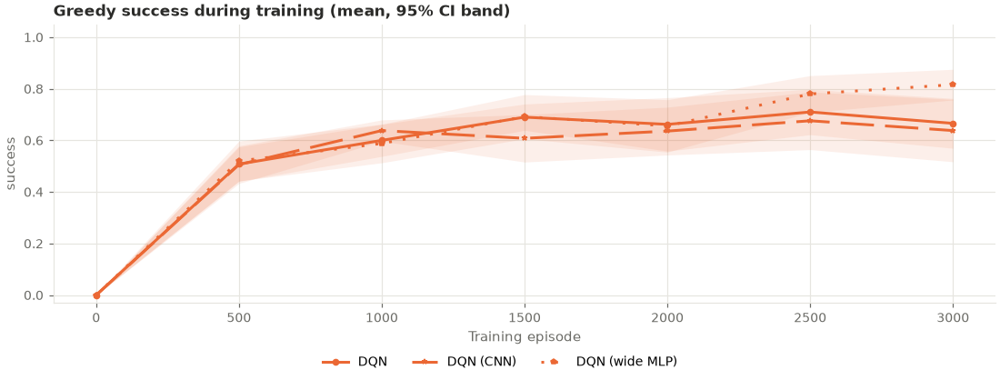
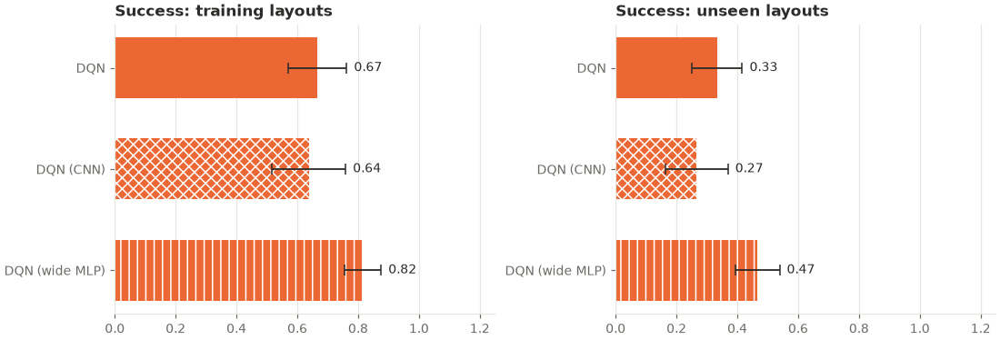

# cnn_generalization: analysis

Protocol: [`PROTOCOL.md`](PROTOCOL.md), hypotheses H1 and H2 (written before any run).
Raw outputs: `results.csv` (final greedy evaluation per seed and split), `curves.csv`
(greedy evaluation on all 50 training mazes every 500 episodes), `summary.csv`,
`buffer_diagnostics.csv`, `run.log`. Trained networks: `models/` (see below).

## Answer

**The convolutional network did not help DQN, either on new mazes or in learning its
training mazes.** On the 50 held-out mazes the CNN reached the goal in 0.27 of them
against 0.33 for the standard MLP (behind in 7 of 10 seeds), and its learning speed was
0.617 against 0.639. Neither difference is significant (Holm-adjusted p = 0.55 for
both). By the pre-registered rule, both are "no evidence of a difference". That is not
evidence that the CNN is harmless, and the point estimates are on the wrong side.

| Hypothesis | DQN (MLP) | DQN (CNN) | Seeds ahead / tied / behind | p | Holm-adjusted p | Verdict |
|---|---|---|---|---|---|---|
| H1: held-out success | 0.33 ± 0.08 | 0.27 ± 0.10 | 3 / 0 / 7 | 0.277 | 0.55 | No evidence of a difference |
| H2: learning speed | 0.639 | 0.617 | 5 / 0 / 5 | 0.517 | 0.55 | No evidence of a difference |

*Learning speed = greedy success on the 50 training mazes averaged over the evaluations
at episodes 500, 1000, …, 3000. "Ahead" means the CNN scored higher.*

**Exploratory: the wide MLP did best.** The capacity-matched MLP (288 × 288, about as
many weights as the CNN) was the only arm to stand out. On held-out mazes it reached
0.47 against 0.33 for the standard MLP (p = 0.019, ahead in 7 of 10 seeds, 1 tie) and
against 0.27 for the CNN (p = 0.004, ahead in 9 of 10). This arm was exploratory: these
p-values are not corrected, and the protocol does not allow them to be read as a
confirmed result. They are a reason to test network width in a new pre-registered study
with fresh seeds, not a finding.

## Results (greedy, mean ± 95% CI over seeds 500–509)

**Held-out mazes (layouts 9400–9449, never seen in training)**

| Arm | Success | Path efficiency | Steps | Collisions | Revisits | Task reward |
|---|---|---|---|---|---|---|
| DQN (MLP 128 × 128) | 0.33 ± 0.08 | 0.32 ± 0.08 | 71.1 ± 7.0 | 15.8 ± 6.7 | 47.4 ± 8.1 | −2.18 ± 0.45 |
| DQN (CNN) | 0.27 ± 0.10 | 0.26 ± 0.10 | 77.0 ± 8.9 | 22.8 ± 8.6 | 47.0 ± 7.1 | −2.66 ± 0.62 |
| DQN (wide MLP 288 × 288) | 0.47 ± 0.07 | 0.45 ± 0.07 | 59.8 ± 6.3 | 11.6 ± 3.6 | 38.6 ± 7.6 | −1.54 ± 0.32 |

**Training mazes (layouts 9300–9349)**

| Arm | Success | Path efficiency | Steps | Collisions | Revisits | Task reward |
|---|---|---|---|---|---|---|
| DQN (MLP 128 × 128) | 0.67 ± 0.10 | 0.66 ± 0.10 | 43.1 ± 8.1 | 6.0 ± 4.0 | 25.8 ± 8.5 | −0.61 ± 0.44 |
| DQN (CNN) | 0.64 ± 0.12 | 0.64 ± 0.12 | 45.3 ± 10.2 | 8.7 ± 5.7 | 25.8 ± 8.7 | −0.80 ± 0.60 |
| DQN (wide MLP 288 × 288) | 0.82 ± 0.06 | 0.81 ± 0.06 | 30.3 ± 4.9 | 3.5 ± 1.9 | 13.8 ± 5.4 | 0.05 ± 0.25 |

**Held-out success per seed (500–509)**

| Arm | 500 | 501 | 502 | 503 | 504 | 505 | 506 | 507 | 508 | 509 |
|---|---|---|---|---|---|---|---|---|---|---|
| DQN (MLP) | 0.24 | 0.42 | 0.34 | 0.54 | 0.38 | 0.46 | 0.28 | 0.28 | 0.18 | 0.22 |
| DQN (CNN) | 0.38 | 0.12 | 0.22 | 0.30 | 0.18 | 0.30 | 0.58 | 0.26 | 0.26 | 0.06 |
| DQN (wide MLP) | 0.42 | 0.58 | 0.30 | 0.56 | 0.30 | 0.46 | 0.46 | 0.48 | 0.54 | 0.56 |

**Greedy success on the 50 training mazes during training (mean over seeds)**

| Episode | 500 | 1000 | 1500 | 2000 | 2500 | 3000 |
|---|---|---|---|---|---|---|
| DQN (MLP) | 0.51 | 0.60 | 0.69 | 0.66 | 0.71 | 0.67 |
| DQN (CNN) | 0.51 | 0.64 | 0.61 | 0.64 | 0.68 | 0.64 |
| DQN (wide MLP) | 0.52 | 0.59 | 0.69 | 0.66 | 0.78 | 0.82 |

## Exploratory results (not pre-registered as primary; no correction)

- **CNN vs MLP at each evaluation**: the gap was never significant (−0.08 to +0.04,
  p ≥ 0.10). The curves overlap from episode 500 to 3,000.
- **CNN vs MLP, other metrics**: no difference was significant on either split (path
  efficiency, steps, collisions, revisits; all p ≥ 0.16). The CNN collided more on
  held-out mazes (22.8 vs 15.8 per episode, p = 0.17).
- **Wide MLP vs MLP**: ahead on final training success (0.82 vs 0.67, p = 0.011) and on
  held-out path efficiency (0.45 vs 0.32, p = 0.019), with fewer steps on both splits
  (p ≤ 0.019) and fewer revisits on the training mazes (13.8 vs 25.8, p = 0.015). Its
  learning speed (0.675 vs 0.639, p = 0.26) was not significantly different: the two
  curves are level until episode 2,000, and the wide MLP pulls ahead only in the last
  1,000 episodes.
- **Wide MLP vs CNN**: ahead on held-out success (0.47 vs 0.27, p = 0.004) and final
  training success (0.82 vs 0.64, p = 0.009); learning speed 0.675 vs 0.617 (p = 0.14).
- **By maze difficulty** (held-out success re-evaluated from each run's final
  checkpoint, which reproduces the saved results exactly): on the 29 held-out mazes with
  the minimum path length (12), CNN 0.35 and wide MLP 0.61 against 0.44 for the MLP
  (p = 0.23 and 0.015); on the 21 longer ones, 0.15 and 0.27 against 0.19 (p = 0.55 and
  0.10).
- **Compute**: mean environment steps per run were 139,000 (MLP), 149,000 (CNN) and
  133,000 (wide MLP). A CNN run took about 32 minutes of wall-clock time with two runs
  in parallel, against about 7–10 minutes for either MLP, so about 3–4× the cost for no
  measurable gain.

## Interpretation

Sharing the same 3×3 filters across the 5×5 window did not help this agent recognise
mazes it had not seen, and it did not learn its training mazes sooner. The study does
not say why. Some features of the design are consistent with it, and none was tested
on its own:

1. **The window is tiny.** With padding, a 3×3 filter on a 5×5 window sees the edge of
   the window at almost every position, so there is little "same pattern in a different
   place" for weight sharing to exploit. The MLP already sees all 25 cells at once.
2. **The CNN's head is shallower.** By design (fixed in advance), the CNN feeds its
   800 features into one hidden layer of 128, while both MLPs have two hidden layers.
3. **No tuning.** The CNN used the MLP's learning rate and the channel counts fixed
   before the run. A tuned CNN might do better; tuning it on these seeds would mean
   tuning on the test set.

The exploratory result points the other way from the hypothesis: **more capacity in a
plain MLP**, not convolution, was associated with better held-out success. Because
`dqn_wide` was exploratory, this needs confirmation with fresh seeds and layouts before
it can be claimed. If it holds, it would be the first change in Stages C–H to improve
success on new mazes, and the first to do so by changing what the network can
represent rather than how it is trained.

Plain DQN's held-out success here (0.33) is much lower than in Stage H (0.57), although
this held-out set has more minimum-length mazes (29 of 50, against 25). This study's
training set has fewer of them (25 of 50, against 29), which may matter, but this was
not tested. As before, only comparisons within one study, on the same mazes and seeds,
are meaningful.

## Trained networks (`models/`)

`models/<arm>_s<seed>.pt` holds each run's final network: the run's config and the
trained (online) network only, without the replay buffer, target network or optimizer
state (`training.export_weights`; 0.11 MB per MLP, 0.44 MB per CNN or wide MLP, 9.8 MB in
all). Load one with `load_agent` or the dashboard's Checkpoints tab to evaluate it or
watch it play. They cannot resume training. Each file was checked after export: it
reproduces its run's saved training and held-out results exactly (success, steps and
reward on all 100 mazes). The full checkpoints (about 14 MB each) were kept outside the
repository.

## Replay buffer

From `buffer_diagnostics.csv`: runs added about 139,000 (MLP), 149,000 (CNN) and
133,000 (wide MLP) transitions; every 20,000-transition buffer overwrote most of them.

## Deviations from the protocol

- **The run was interrupted once.** The first attempt, with `--workers 3` inside Claude
  Code, was stopped because the laptop was low on memory. By then 6 MLP runs (seeds
  500–505) had finished and 3 more (506–508) were 800–1,000 episodes in. As the
  protocol requires, it was resumed with the same command, not restarted, with
  `--workers 2` (the protocol allows the same or fewer workers), this time in a
  separate PowerShell window. The number of workers does not change results, and
  resumed runs continue from their last checkpoint and reproduce an uninterrupted run
  exactly (both tested).
- **`run.log` was regenerated.** The resumed session's console output was not saved to
  a file. After all 30 runs had finished, the same command was run once more: it only
  reloads the finished runs and reprints the log. `results.csv`, `curves.csv`,
  `summary.csv` and `buffer_diagnostics.csv` were byte-identical before and after.
- **Added after the run**: the `models/` folder and the code to write and read
  weights-only files. This adds outputs and changes no result.
- Otherwise none.
