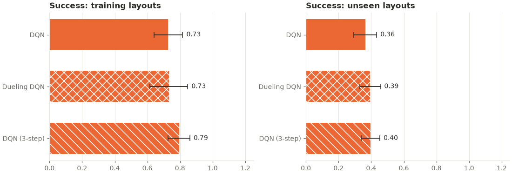

# dqn_variants_generalization: analysis

Protocol: [`../dqn_variants_speed/PROTOCOL.md`](../dqn_variants_speed/PROTOCOL.md),
hypotheses H3 and H4 (written before any run). Raw outputs: `results.csv` (final greedy
evaluation per seed and split), `curves.csv` (greedy evaluation on the training mazes every
500 episodes), `summary.csv`, `buffer_diagnostics.csv`, `run.log`.

## Answer

**No evidence that dueling heads or 3-step returns help DQN on mazes it has never seen.**
Both variants were slightly ahead of plain DQN on the 50 held-out mazes (+0.03 each), and
neither difference is anywhere near significant.

| Hypothesis | DQN | Variant | Seeds ahead / tied / behind | p | Holm-adjusted p | Verdict |
|---|---|---|---|---|---|---|
| H3: dueling, held-out success | 0.36 ± 0.07 | 0.39 ± 0.06 | 6 / 2 / 2 | 0.508 | 0.93 | No evidence of a difference |
| H4: 3-step, held-out success | 0.36 ± 0.07 | 0.40 ± 0.06 | 6 / 0 / 4 | 0.465 | 0.93 | No evidence of a difference |

## Results (greedy, mean ± 95% CI over seeds 300–309)

**Held-out mazes (layouts 8200–8249, never seen in training)**

| Arm | Success | Path efficiency | Steps | Collisions | Revisits | Task reward |
|---|---|---|---|---|---|---|
| DQN | 0.36 ± 0.07 | 0.36 ± 0.07 | 68.6 ± 5.9 | 14.3 ± 5.6 | 46.0 ± 8.0 | −2.02 ± 0.34 |
| Dueling DQN | 0.39 ± 0.06 | 0.38 ± 0.06 | 66.1 ± 5.4 | 19.3 ± 5.9 | 37.8 ± 6.8 | −2.04 ± 0.35 |
| DQN (3-step) | 0.40 ± 0.06 | 0.39 ± 0.06 | 65.9 ± 4.9 | 20.3 ± 4.5 | 36.1 ± 7.4 | −2.06 ± 0.25 |

**Training mazes (layouts 8100–8149)**

| Arm | Success | Path efficiency | Steps | Collisions | Revisits |
|---|---|---|---|---|---|
| DQN | 0.73 ± 0.09 | 0.71 ± 0.09 | 37.6 ± 7.4 | 4.4 ± 2.7 | 21.9 ± 6.6 |
| Dueling DQN | 0.73 ± 0.12 | 0.72 ± 0.11 | 37.3 ± 9.8 | 9.1 ± 5.3 | 16.4 ± 7.6 |
| DQN (3-step) | 0.79 ± 0.07 | 0.78 ± 0.07 | 32.1 ± 5.6 | 7.6 ± 3.6 | 12.0 ± 5.4 |

**Held-out success per seed (300–309)**

| Arm | Seeds 300–309 |
|---|---|
| DQN | 0.34, 0.46, 0.30, 0.42, 0.40, 0.40, 0.54, 0.24, 0.24, 0.30 |
| Dueling DQN | 0.36, 0.46, 0.60, 0.42, 0.42, 0.30, 0.36, 0.30, 0.36, 0.36 |
| DQN (3-step) | 0.40, 0.34, 0.38, 0.40, 0.30, 0.44, 0.44, 0.56, 0.28, 0.42 |

## Exploratory results (not pre-registered as primary; no correction)

- **Training mazes:** no significant difference in final success (3-step vs DQN +0.07,
  p = 0.209; dueling +0.00, p = 0.976) or learning speed (0.716 and 0.687 vs 0.681,
  p = 0.261 and 0.873). Unlike the single maze in `dqn_variants_speed`, 3-step returns did
  not measurably speed up learning across 50 mazes with a local view.
- **Fewer loops, more wall bumps.** On held-out mazes both variants revisited cells less
  than plain DQN (37.8 and 36.1 vs 46.0 per episode; p = 0.092 and 0.059) and hit walls
  more (19.3 and 20.3 vs 14.3; p = 0.183 and 0.073). None of this is significant, and the
  task reward was the same in all three arms (about −2.0).
- Greedy training success during training, mean over seeds:

  | Episode | 500 | 1,000 | 1,500 | 2,000 | 2,500 | 3,000 |
  |---|---|---|---|---|---|---|
  | DQN | 0.61 | 0.64 | 0.62 | 0.75 | 0.74 | 0.73 |
  | Dueling DQN | 0.52 | 0.64 | 0.68 | 0.75 | 0.80 | 0.73 |
  | DQN (3-step) | 0.50 | 0.65 | 0.77 | 0.81 | 0.78 | 0.79 |

## Interpretation

On a single maze 3-step returns sped DQN up a lot (`dqn_variants_speed`), but across 50
mazes seen through a 5×5 window the effect on learning speed was small and not
significant, and neither variant measurably improved success on new mazes. This is the
same pattern as reward shaping (`shaping_speed` vs `shaping_generalization`): a change
that makes one maze easier to learn did not transfer to unseen mazes. With 10 seeds, a
held-out difference of +0.03 is far below what this design can detect.

## Replay buffer

From `buffer_diagnostics.csv`: runs added 126,000–136,000 transitions on average and the
20,000-transition buffers overwrote most of them, in every arm.

## Deviations from the protocol

None. 30 runs, `--workers 4`, 87 minutes.
