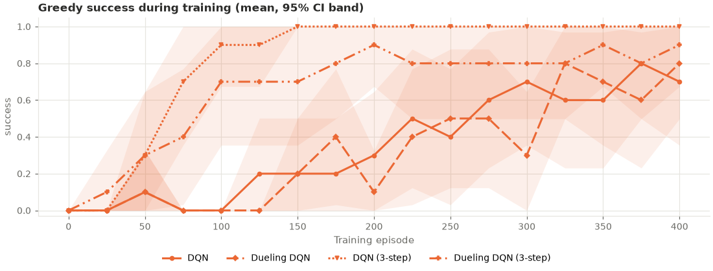

# dqn_variants_speed: analysis

Protocol: `PROTOCOL.md` (written before any run; covers this experiment and
`dqn_variants_generalization`). Raw outputs: `results.csv` (final greedy evaluation per
seed), `curves.csv` (greedy evaluation every 25 episodes), `summary.csv`,
`buffer_diagnostics.csv`, `run.log`.

## Answer

**3-step returns made DQN learn this maze much faster; dueling heads made no measurable
difference.** H2 is significant after Holm-Bonferroni correction; H1 is not.

| Hypothesis | DQN | Variant | Seeds ahead / tied / behind | p | Holm-adjusted p | Verdict |
|---|---|---|---|---|---|---|
| H1: dueling learns faster | 0.369 | 0.338 | 3 / 0 / 7 | 0.823 | 0.823 | No evidence of a difference |
| H2: 3-step returns learn faster | 0.369 | 0.863 | 10 / 0 / 0 | 0.0001 | 0.0003 | **Supported** |

Learning speed = greedy success averaged over the 16 evaluations during training
(episodes 25–400), one value per seed, compared with a two-sided permutation test.

## Final performance (greedy, mean ± 95% CI over seeds 300–309)

| Arm | Success | Path efficiency | Steps | Mistakes |
|---|---|---|---|---|
| DQN | 0.70 ± 0.35 | 0.70 ± 0.35 | 41.2 ± 29.0 | 29.8 ± 34.3 |
| Dueling DQN | 0.80 ± 0.30 | 0.80 ± 0.30 | 32.8 ± 25.3 | 20.0 ± 30.2 |
| DQN (3-step) | 1.00 ± 0.00 | 1.00 ± 0.00 | 16.0 ± 0.0 | 0.0 ± 0.0 |
| Dueling DQN (3-step) | 0.90 ± 0.23 | 0.90 ± 0.23 | 24.4 ± 19.0 | 9.5 ± 21.5 |

The shortest path is 16 steps; every successful final episode took it. No final-success
difference is significant (exploratory; 3-step vs DQN +0.30, p = 0.212).

## When each run first reached greedy success 1.0

| Arm | Seeds 300–309 (training episode; "never" = not by episode 400) |
|---|---|
| DQN | never, never, 225, 225, 125, 375, 250, 50, 125, 150 |
| Dueling DQN | 325, 50, 275, never, 175, 150, 175, never, 225, 200 |
| DQN (3-step) | 100, 75, 50, 100, 75, 50, 150, 50, 75, 75 |
| Dueling DQN (3-step) | 50, never, 50, 100, 175, 200, 75, 50, 75, 25 |

Every 3-step run solved the maze by episode 150 and still solved it at episode 400. Plain
DQN never solved it in 2 seeds, and one plain DQN run solved it and then lost it again
by the end. No dueling or 3-step run lost a solution it had found.

## Exploratory comparisons (no correction)

| Comparison (learning speed) | Difference | p |
|---|---|---|
| Dueling + 3-step vs DQN | +0.331 (0.700 vs 0.369) | 0.031 |
| Dueling + 3-step vs dueling | +0.362 | 0.015 |
| Dueling + 3-step vs 3-step | −0.163 (0.700 vs 0.863) | 0.217 |
| 3-step vs dueling | +0.525 | < 0.001 |

Adding dueling heads to 3-step returns did not make it faster; the combined arm was
slower than 3-step alone on average, but not significantly.

## Why 3-step returns help here

In a maze the only large reward is at the goal. One-step DQN moves that information back
one cell per update, so the start, 16 steps away, learns about the goal slowly. A 3-step
target carries it back three cells at a time. The same reasoning explains why reward
shaping helped DQN in `shaping_speed`.

## What this does and doesn't show

- Faster learning on **one** 9×9 maze (layout 8000) with n fixed at 3. It does not show
  that 3-step returns help in general, or at other n.
- The 3-step returns include exploratory moves and are not corrected for them. On this
  task that bias did not stop any 3-step run from reaching the shortest path.
- Dueling's lack of an effect is "no evidence of a difference", not "no effect": with 10
  seeds a small effect could be missed.

## Deviations from the protocol

None. 40 runs, `--workers 4`, 22 minutes.
