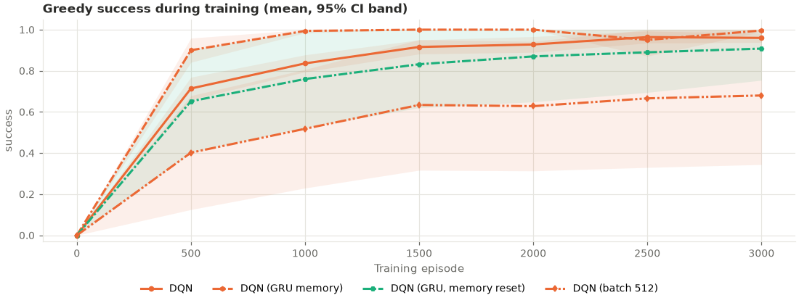
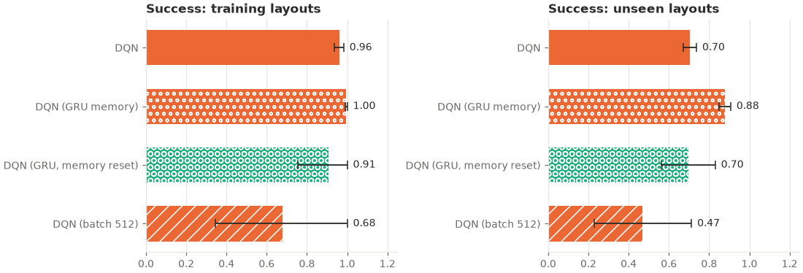

# memory_vs_replay: analysis

Protocol: [`PROTOCOL.md`](PROTOCOL.md), hypotheses H1–H3 (written before any run).
Analysis script: [`analyze.py`](analyze.py) (written before the run, run unchanged); its
full output is [`analysis_output.txt`](analysis_output.txt). Raw outputs: `results.csv`
(final greedy evaluation per seed and split), `curves.csv` (greedy evaluation on all 50
training mazes every 500 episodes), `summary.csv`, `buffer_diagnostics.csv`,
`eps005.json` (the ε = 0.05 secondary evaluation), `run.log`. Trained networks:
`models/` (see below).

## Answer

**It is the memory.** Stage F could not tell whether the GRU agent's large gain on new
mazes came from its memory or from how it is trained (runs of 16 consecutive steps, 8×
as many trained steps per update). This study keeps the recurrent network and its
training exactly as they were and only clears the memory before every step. Without
the memory, held-out success fell from 0.88 to 0.70, behind in all 10 seeds
(Holm-adjusted p < 0.001), which is the same as the standard DQN (0.70; exploratory,
p = 0.99). The recurrent agent's training by itself added nothing measurable.

**Giving the standard network 8× more trained steps per update did not help.** With
batch 512 the MLP reached 0.47 against 0.70 (Holm-adjusted p = 0.061): no evidence of a
difference. Three of its ten runs never learned the task at all (see below), so this is
not evidence that batch 512 *hurts* either.

**Stage F replicated.** With fresh seeds and mazes, the GRU agent again beat the
standard DQN on held-out mazes: 0.88 against 0.70, ahead in all 10 seeds
(Holm-adjusted p < 0.001).

| Hypothesis | Compared | Means | Seeds ahead / tied / behind | p | Holm-adjusted p | Verdict |
|---|---|---|---|---|---|---|
| H1: the memory itself | GRU vs GRU with memory reset every step | 0.88 vs 0.70 | 10 / 0 / 0 | < 0.001 | < 0.001 | **Memory helps** |
| H2: more trained steps per update | MLP batch 512 vs MLP batch 64 | 0.47 vs 0.70 | 3 / 1 / 6 | 0.061 | 0.061 | No evidence of a difference |
| H3: Stage F replication | GRU vs MLP | 0.88 vs 0.70 | 10 / 0 / 0 | < 0.001 | < 0.001 | **Replicated** |

*Held-out greedy success, mean over seeds 800–809. Two-sided permutation tests on 10 vs
10 per-seed values, 200,000 resamples. "p < 0.001" is shown for complete separation (the
script printed 0.0000). "Ahead" means the first arm scored higher.*

**How much of the gain is the memory?** As the protocol specifies, since H1 and H3 are
both significant this is described from `dqn_rnn_nomem`'s position (exploratory,
descriptive): the GRU beat the standard DQN by 0.17; with its memory cleared at every
step it was 0.01 *below* the standard DQN (0.696 vs 0.704). So, within this study,
essentially all of the gain over the standard DQN goes with the memory, and none of it
with the sequence replay or the larger network.

## Results (greedy, mean ± 95% CI over seeds 800–809)

**Held-out mazes (layouts 10001–10050, never seen in training)**

| Arm | Success | Path efficiency | Steps | Timeouts | Collisions | Revisits | Revisits per step | Task reward |
|---|---|---|---|---|---|---|---|---|
| DQN (MLP, batch 64) | 0.70 ± 0.03 | 0.70 ± 0.03 | 38.9 ± 2.8 | 0.30 ± 0.03 | 4.0 ± 2.5 | 23.7 ± 3.4 | 0.61 ± 0.06 | −0.39 ± 0.16 |
| DQN (MLP, batch 512) | 0.47 ± 0.24 | 0.47 ± 0.24 | 59.3 ± 21.0 | 0.53 ± 0.24 | 26.0 ± 25.2 | 24.8 ± 5.9 | 0.50 ± 0.15 | −1.97 ± 1.70 |
| DQN (GRU memory) | 0.88 ± 0.03 | 0.86 ± 0.03 | 24.5 ± 2.3 | 0.12 ± 0.03 | 3.2 ± 2.0 | 8.1 ± 2.1 | 0.32 ± 0.07 | 0.30 ± 0.15 |
| DQN (GRU, memory reset) | 0.70 ± 0.13 | 0.69 ± 0.13 | 39.7 ± 11.6 | 0.30 ± 0.13 | 3.3 ± 5.2 | 25.4 ± 8.1 | 0.63 ± 0.03 | −0.40 ± 0.68 |

**Training mazes (layouts 9900–9949)**

| Arm | Success | Path efficiency | Steps | Timeouts | Collisions | Revisits | Revisits per step | Task reward |
|---|---|---|---|---|---|---|---|---|
| DQN (MLP, batch 64) | 0.96 ± 0.02 | 0.96 ± 0.02 | 17.8 ± 1.8 | 0.04 ± 0.02 | 0.4 ± 0.5 | 3.4 ± 1.8 | 0.18 ± 0.08 | 0.69 ± 0.10 |
| DQN (MLP, batch 512) | 0.68 ± 0.34 | 0.68 ± 0.34 | 41.8 ± 28.8 | 0.32 ± 0.34 | 23.8 ± 27.3 | 7.3 ± 6.4 | 0.15 ± 0.06 | −1.10 ± 2.13 |
| DQN (GRU memory) | 1.00 ± 0.01 | 0.99 ± 0.01 | 14.9 ± 0.5 | 0.00 ± 0.01 | 0.0 ± 0.0 | 0.4 ± 0.5 | 0.02 ± 0.03 | 0.84 ± 0.02 |
| DQN (GRU, memory reset) | 0.91 ± 0.15 | 0.91 ± 0.15 | 22.2 ± 13.1 | 0.09 ± 0.15 | 2.6 ± 5.9 | 6.1 ± 8.8 | 0.17 ± 0.13 | 0.42 ± 0.77 |

**Held-out success per seed (800–809)**

| Arm | 800 | 801 | 802 | 803 | 804 | 805 | 806 | 807 | 808 | 809 |
|---|---|---|---|---|---|---|---|---|---|---|
| DQN (MLP, batch 64) | 0.72 | 0.66 | 0.74 | 0.70 | 0.66 | 0.80 | 0.70 | 0.70 | 0.72 | 0.64 |
| DQN (MLP, batch 512) | 0.76 | 0.00 | 0.66 | 0.74 | 0.66 | 0.70 | 0.76 | 0.00 | 0.42 | 0.00 |
| DQN (GRU memory) | 0.84 | 0.90 | 0.82 | 0.88 | 0.84 | 0.86 | 0.94 | 0.94 | 0.88 | 0.88 |
| DQN (GRU, memory reset) | 0.76 | 0.72 | 0.74 | 0.18 | 0.76 | 0.78 | 0.82 | 0.80 | 0.64 | 0.76 |

The worst GRU seed (802, 0.82) did at least as well as the best seed of every other arm
(the best memory-reset seed, 806, tied it at 0.82).

**Greedy success on the 50 training mazes during training (mean over seeds)**

| Episode | 500 | 1000 | 1500 | 2000 | 2500 | 3000 |
|---|---|---|---|---|---|---|
| DQN (MLP, batch 64) | 0.71 | 0.84 | 0.92 | 0.93 | 0.96 | 0.96 |
| DQN (MLP, batch 512) | 0.40 | 0.52 | 0.63 | 0.63 | 0.67 | 0.68 |
| DQN (GRU memory) | 0.90 | 0.99 | 1.00 | 1.00 | 0.95 | 1.00 |
| DQN (GRU, memory reset) | 0.65 | 0.76 | 0.83 | 0.87 | 0.89 | 0.91 |

## Secondary: ε = 0.05 (pre-specified, exploratory, no correction)

Every final network was played 5 times over the 50 held-out mazes with ε = 0.05
(evaluation seed 20,000 + run seed), after its greedy result had been re-checked
against the saved one (all 40 matched exactly).

| Arm | Greedy | ε = 0.05 |
|---|---|---|
| DQN (MLP, batch 64) | 0.70 | 0.77 ± 0.03 |
| DQN (MLP, batch 512) | 0.47 | 0.53 ± 0.26 |
| DQN (GRU memory) | 0.88 | 0.90 ± 0.03 |
| DQN (GRU, memory reset) | 0.70 | 0.76 ± 0.13 |

The conclusions do not change: memory vs memory reset 0.90 vs 0.76 (p < 0.001, 10/10
seeds); batch 512 vs 64, 0.53 vs 0.77 (p = 0.075); GRU vs MLP, 0.90 vs 0.77 (p < 0.001,
10/10); memory reset vs MLP, 0.76 vs 0.77 (p = 0.995). As in Stage K, every arm did
better with a little randomness than greedily, and the GRU, which loops least, gained
least.

## Other exploratory results (no correction)

- **Without memory, the agent loops like a standard one.** Held-out revisits per step:
  GRU 0.32, memory reset 0.63, standard MLP 0.61. The memory-reset arm revisited more
  per step than the GRU in all 10 seeds (p < 0.001). In Stage F the drop in revisits per
  step was modest (0.60 → 0.49, p = 0.048); here it is large (0.61 → 0.32, lower in 9 of
  10 seeds, p < 0.001). Collisions did not differ (p ≥ 0.60), so the memory helps the
  agent avoid going back, not avoid walls.
- **Learning speed** (training-maze success averaged over the 6 evaluations): GRU 0.973,
  memory reset 0.819 (p < 0.001, 9 of 10 seeds), MLP 0.886 (GRU vs MLP p < 0.001, 10/10),
  MLP batch 512 0.588 (vs MLP p = 0.037, 4 of 10 seeds ahead).
- **Final training success**: GRU 1.00 vs memory reset 0.91 (p = 0.031) and vs MLP 0.96
  (p = 0.004).
- **Path efficiency on held-out mazes**: GRU 0.86 against 0.69 (memory reset) and 0.70
  (MLP), p < 0.001 for both.

## Runs that never learned (post hoc, descriptive)

Not in the protocol; reported because they dominate the batch-512 result.

- **Three batch-512 runs (seeds 801, 807, 809) never learned the task.** Their greedy
  success on the training mazes was 0.00 at every evaluation (episodes 500 to 3,000), and
  their final greedy policy timed out on every maze, hitting walls 67–89 times per episode.
  During training their success (with exploration) peaked at about 0.16 early on and fell
  towards 0 as ε fell, while their mean TD error grew several-fold (from 0.03–0.08 in the
  first 250 episodes to 0.26–0.54 in the last 250), unlike the runs that learned (seed 800:
  about 0.01–0.02 throughout). This looks like unstable
  learning, not over-fitting. None of these runs was interrupted. The cause was not
  investigated (for example, the learning rate was kept at 1e-3, as the protocol says, so
  each update moves the network by the gradient of a larger batch).
- **On the 7 batch-512 seeds that did learn**, held-out success averaged 0.67 against
  0.72 for the standard MLP on the same 7 seeds. This is a post-hoc subset and is not
  tested.
- **One memory-reset run (seed 803) learned late.** Its greedy training success was 0.00
  up to episode 2,000 and reached 0.30 at the end; held-out 0.18. It was already at 0.00
  at episode 1,500, before the run was paused (see "Deviations"). Without it the
  memory-reset arm averages 0.75 on held-out mazes, still below the GRU in every seed and
  close to the standard MLP.
- Every GRU and every standard MLP run learned.

## Interpretation

Stage F showed that a DQN with a GRU memory solved far more new mazes than a standard
DQN, but left two explanations open: the memory, or the recurrent agent's training
(sequence replay with 8× as many trained steps per update). This study separates them,
and the answer is clear: with the training identical and only the memory removed, the
agent did exactly as well as a standard DQN, and the standard DQN given as many trained
steps per update did no better (and three of its runs failed). The gain is the memory.

The memory's effect is also visible in behaviour: without it the agent went back to
places it had been about twice as often per step (0.63 against 0.32), the same rate as a
standard DQN (0.61). With a 5×5 view, one observation cannot say whether a place has
been visited; a memory that lasts through the episode can, and an agent that does not
retrace its steps reaches the goal more often.

What the study does **not** show:

1. **What the memory stores.** Fewer revisits are consistent with remembering visited
   places, but nothing here tests that directly (for example by probing the GRU's state).
2. **Other ways of using more data per update.** Batch 512 at learning rate 1e-3 is one
   setting. A tuned learning rate, or more updates instead of larger ones, might behave
   differently; H2 says only that this setting gave no evidence of a gain.
3. **No tuning.** All settings were fixed in advance.

**The size of the gain depends on the baseline.** The standard DQN did far better here
(0.70 held-out) than in Stage F (0.29) and Stage E (0.33), and the GRU's margin was
correspondingly smaller (+0.17 against +0.44 in Stage F). Plain DQN's held-out success
has now ranged from 0.29 to 0.70 across studies with the same settings and similar
mazes, so only comparisons within one study, on the same mazes and seeds, are
meaningful.

## Trained networks (`models/`)

`models/<arm>_s<seed>.pt` holds each run's final network: the run's config and the
trained (online) network only, without the replay buffer, target network or optimizer
state (`training.export_weights`; 0.11 MB per MLP, 0.44 MB per GRU, 11.1 MB in all).
Load one with `load_agent` or the dashboard's
Checkpoints tab to evaluate it or watch it play; they cannot resume training. Each file
was checked after export: it reproduces its run's saved training and held-out results
exactly (success, steps, reward, revisits and collisions on all 100 mazes). The full
checkpoints were kept outside the repository.

## Compute

Mean environment steps per run: 106,567 (MLP), 167,094 (batch 512; more because its
failed runs time out), 103,790 (GRU) and 124,890 (memory reset). With two runs in
parallel an MLP run took about 7 minutes and a batch-512 run about 14. A GRU run took
about 50–70 minutes, with or without its memory. The script's per-run times for the two
GRU arms (36–57 minutes on average, 9–97 minutes per run) are not reliable, because
several runs spanned a pause (see below). The ε = 0.05 evaluation of all 40 networks
took a few minutes. In all, the experiment ran for about 11.4 hours over three
sessions, within the protocol's estimate of 10–16 hours.

## Replay buffer

From `buffer_diagnostics.csv`: every run filled its 20,000-transition buffer and
overwrote most of what it added (the arms' mean environment steps are listed under
"Compute").

## Deviations from the protocol

- **The run was stopped and resumed twice**, both times at the project owner's request.
  As the protocol requires, every stop was resumed with the same command, never
  restarted, always with `--workers 2`, and in a PowerShell window outside Claude Code.
  Resumed runs continue from their last checkpoint (every 500 episodes) and reproduce an
  uninterrupted run exactly (tested); episodes after the last checkpoint are played
  again.
  1. 2026-11-09, 15:17 to 17:10. All 20 MLP runs and GRU seed 800 had finished. GRU seed
     801 continued from episode 2,000 (6 episodes past it were played again); GRU seed
     802 had no checkpoint yet and restarted from episode 0.
  2. 2026-11-09, 23:37 to 2026-11-10, 16:02. 33 runs had finished. Memory-reset seed 804
     continued from episode 2,000, seed 803 from episode 1,500 (about 170 episodes
     played again); seeds 805–809 had not started. The run finished at 18:05.
- **`run.log` was regenerated.** The console output of the first session was not kept,
  and the later sessions appended in UTF-16. After all 40 runs had finished, the same
  command was run once more: it only reloads the finished runs and reprints the log.
  `results.csv`, `curves.csv`, `summary.csv`, `buffer_diagnostics.csv` and
  `experiment.json` were byte-identical before and after.
- **The "runs that never learned" section is post hoc** and descriptive only.
- Otherwise none. The analysis script was written before the results existed and was
  run unchanged.
