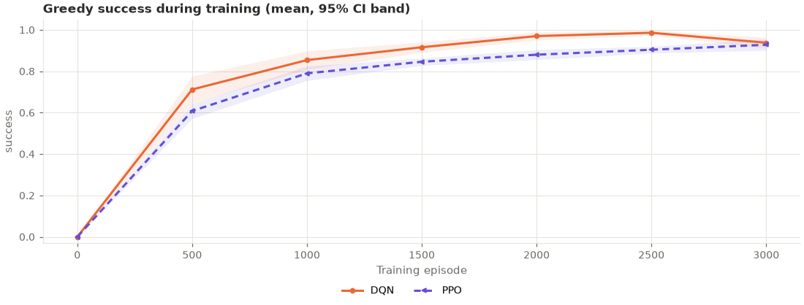
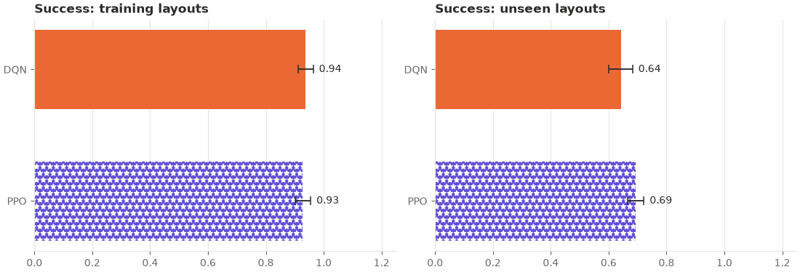

# ppo_generalization: analysis

Protocol: [`PROTOCOL.md`](PROTOCOL.md), hypotheses H1 and H2 (written before any run).
Raw outputs: `results.csv` (final greedy evaluation per seed and split), `curves.csv`
(greedy evaluation on all 50 training mazes every 500 episodes), `summary.csv`,
`buffer_diagnostics.csv` (DQN only; PPO has no replay buffer), `run.log`. Trained
networks: `models/` (see below).

## Answer

**PPO solved slightly more new mazes than DQN but learned its training mazes more
slowly.** Both pre-registered differences are significant after correction, in
opposite directions:

| Hypothesis | DQN | PPO | Seeds ahead / tied / behind | p | Holm-adjusted p | Verdict |
|---|---|---|---|---|---|---|
| H1: held-out success | 0.64 ± 0.04 | 0.69 ± 0.03 | 8 / 0 / 2 | 0.037 | 0.037 | **PPO better** (with these settings) |
| H2: learning speed | 0.896 | 0.826 | 0 / 0 / 10 | 0.0001 | 0.0003 | **PPO slower** (with these settings) |

*Learning speed = greedy success on the 50 training mazes averaged over the evaluations
at episodes 500, 1000, …, 3000. "Ahead" means PPO scored higher. Permutation tests on 10
per-seed values, 20,000 resamples.*

The held-out difference is small (+0.05) and only just below the threshold after
correction, so it is the weaker of the two results. The learning-speed difference is
clear: PPO was behind at every evaluation up to episode 2,500, and level only at the end
(final training success 0.93 vs 0.94, p = 0.63). As the protocol says, both results are
about these two algorithms with their standard settings, not about tuned versions.

**Exploratory: PPO did much better when it sampled its moves.** Played on the same
held-out mazes with its moves sampled from its policy instead of always taking the most
likely one, PPO reached the goal in 0.90 of them (every seed 0.88–0.92), against 0.69
greedily. Most of its greedy failures were loops that a little randomness escapes. DQN
was not evaluated with random moves, so this is not a comparison between the algorithms
(see "Interpretation").

## Results (greedy, mean ± 95% CI over seeds 700–709)

**Held-out mazes (layouts 9800–9849, never seen in training)**

| Arm | Success | Path efficiency | Steps | Timeouts | Collisions | Revisits | Revisits per step | Task reward |
|---|---|---|---|---|---|---|---|---|
| DQN | 0.64 ± 0.04 | 0.64 ± 0.04 | 44.8 ± 3.4 | 0.36 ± 0.04 | 5.7 ± 2.0 | 27.4 ± 4.8 | 0.61 ± 0.06 | −0.68 ± 0.16 |
| PPO | 0.69 ± 0.03 | 0.68 ± 0.03 | 40.8 ± 2.3 | 0.31 ± 0.03 | 5.0 ± 1.1 | 22.7 ± 3.2 | 0.55 ± 0.05 | −0.45 ± 0.10 |
| PPO, sampled moves (exploratory) | 0.90 ± 0.01 | — | 27.7 ± 1.1 | 0.10 ± 0.01 | — | 9.6 ± 1.1 | — | — |

**Training mazes (layouts 9700–9749)**

| Arm | Success | Path efficiency | Steps | Timeouts | Collisions | Revisits | Revisits per step | Task reward |
|---|---|---|---|---|---|---|---|---|
| DQN | 0.94 ± 0.03 | 0.94 ± 0.03 | 19.9 ± 2.1 | 0.06 ± 0.03 | 0.8 ± 0.9 | 5.2 ± 2.5 | 0.24 ± 0.10 | 0.59 ± 0.11 |
| PPO | 0.93 ± 0.03 | 0.90 ± 0.03 | 21.2 ± 2.2 | 0.07 ± 0.03 | 0.6 ± 0.9 | 6.0 ± 2.2 | 0.27 ± 0.08 | 0.56 ± 0.12 |

**Held-out success per seed (700–709)**

| Arm | 700 | 701 | 702 | 703 | 704 | 705 | 706 | 707 | 708 | 709 |
|---|---|---|---|---|---|---|---|---|---|---|
| DQN | 0.62 | 0.68 | 0.64 | 0.54 | 0.72 | 0.64 | 0.66 | 0.56 | 0.66 | 0.70 |
| PPO | 0.72 | 0.72 | 0.74 | 0.68 | 0.60 | 0.72 | 0.68 | 0.70 | 0.70 | 0.68 |
| PPO, sampled | 0.90 | 0.88 | 0.90 | 0.90 | 0.90 | 0.88 | 0.90 | 0.92 | 0.90 | 0.90 |

**Greedy success on the 50 training mazes during training (mean over seeds)**

| Episode | 500 | 1000 | 1500 | 2000 | 2500 | 3000 |
|---|---|---|---|---|---|---|
| DQN | 0.71 | 0.85 | 0.92 | 0.97 | 0.99 | 0.94 |
| PPO | 0.61 | 0.79 | 0.85 | 0.88 | 0.90 | 0.93 |
| PPO − DQN (p) | −0.10 (0.008) | −0.06 (0.024) | −0.07 (0.0002) | −0.09 (0.0002) | −0.08 (0.0001) | −0.01 (0.63) |

## Exploratory results (not pre-registered as primary; no correction)

- **Held-out, other metrics**: PPO took fewer steps (40.8 vs 44.8, p = 0.044), timed out
  less (0.31 vs 0.36, p = 0.037) and earned more task reward (−0.45 vs −0.68, p = 0.013).
  Path efficiency (0.68 vs 0.64, p = 0.087), revisits (22.7 vs 27.4, p = 0.092; fewer in
  9 of 10 seeds), revisits per step (p = 0.15) and collisions (p = 0.47) were not
  significantly different.
- **By maze difficulty** (held-out success re-evaluated from each run's final
  checkpoint, which reproduces the saved results exactly): on the 25 held-out mazes with
  the minimum path length (12) the two were level (0.85 vs 0.86, p = 1.0); on the 25
  longer ones PPO solved 0.54 against 0.43 (p = 0.0065). PPO's held-out advantage came
  entirely from the longer mazes.
- **Training mazes**: final success level (0.93 vs 0.94, p = 0.63); PPO's paths were
  slightly less direct (path efficiency 0.90 vs 0.94, p = 0.044).
- **Sampled play** (each final PPO network played once on every held-out maze, sampling
  its moves, evaluation seed 10,000 + run seed): success 0.90 ± 0.01, against 0.69 for
  the same networks greedily and 0.64 for greedy DQN (p = 0.0001 for both,
  unpaired tests). Steps fell from 40.8 to 27.7, revisits from 22.7 to 9.6 and timeouts
  from 0.31 to 0.10. The spread across seeds was very small (0.88–0.92).
- **Compute**: mean environment steps per run were 108,000 (DQN) and 87,000 (PPO). A DQN
  run took about 7 minutes with two runs in parallel, a PPO run about 2 minutes, so PPO
  cost about a quarter of DQN's time despite learning more slowly per episode.

## Interpretation

**Value learning vs policy learning.** With their standard settings, DQN learned the 50
training mazes faster and PPO generalised slightly better to new ones, mostly on the
longer mazes. DQN reuses every step many times from its replay buffer, which plausibly
explains its faster start; PPO learns from each step for only 4 passes before
discarding it. Why PPO did better on long held-out mazes was not tested. One possible
reason is that a policy trained with an entropy bonus stays less committed to moves
that worked on the training mazes. The held-out difference is small and only just
significant, so it deserves a replication before much is built on it.

**Greedy play hides what PPO knows.** The most striking result is exploratory: sampling
from PPO's own policy raised held-out success from 0.69 to 0.90, with a very small
spread across seeds. With a 5×5 view, a deterministic agent that reaches a state it
cannot tell apart from an earlier one repeats the same move and loops until it times
out (the problem Stage F's memory addressed). A stochastic policy eventually takes a
different move and escapes. This has two consequences:

1. Greedy evaluation, used throughout this project, understates what a policy agent
   can do on this task.
2. It is **not** evidence that PPO beats DQN by 0.26. DQN was evaluated only greedily.
   A DQN that also took some random moves at evaluation (for example ε = 0.05) might
   escape loops too, and that was not tested. The fair comparison is "both greedy",
   which is H1.

**Comparisons across studies.** Plain DQN did far better here than in Stages E and F
(held-out 0.64 against 0.33 and 0.29; training 0.94 against 0.67 and 0.64), although the
mazes have similar path lengths (25 of 50 held-out mazes at the minimum, mean 15.2
steps; Stage E 29 and 14.9, Stage F 19 and 16.5). The reason is not known. As before,
only comparisons within one study, on the same mazes and seeds, are meaningful. In
particular, PPO's 0.69 here cannot be compared with the GRU network's 0.73 in Stage F.

## Trained networks (`models/`)

`models/<arm>_s<seed>.pt` holds each run's final networks: the run's config and the
trained network(s) only, without the replay buffer or target network (DQN), the
half-collected rollout (PPO) or optimizer state (`training.export_weights`; 0.11 MB per
DQN, 0.22 MB per PPO actor + critic, 3.3 MB in all). Load one with `load_agent` or the
dashboard's Checkpoints tab to evaluate it or watch it play. They cannot resume
training. Each file was checked after export: it reproduces its run's saved training
and held-out results exactly (success, steps, reward, revisits and collisions on all 100
mazes). The full checkpoints were kept outside the repository.

## Replay buffer

From `buffer_diagnostics.csv`: each DQN run added about 108,000 transitions to its
20,000-transition buffer, which overwrote most of them. PPO keeps only its current
rollout (2,048 steps).

## Deviations from the protocol

- **`run.log` was regenerated.** The console output was saved by the run in UTF-16.
  After all 20 runs had finished, the same command was run once more: it only reloads
  the finished runs and reprints the log, in UTF-8. `results.csv`, `curves.csv`,
  `summary.csv`, `buffer_diagnostics.csv` and `experiment.json` were byte-identical
  before and after.
- **The sampled-play comparison** used the existing unpaired permutation test, the same
  test as every other comparison; a paired test of the same networks greedy vs sampled
  would be more powerful but was not specified. Every sampled seed was above its own
  greedy result.
- Otherwise none. The run was not interrupted, the analysis script was written before
  the results existed and was run unchanged, and the run took about 46 minutes against
  the 1–1.5 hours expected.
