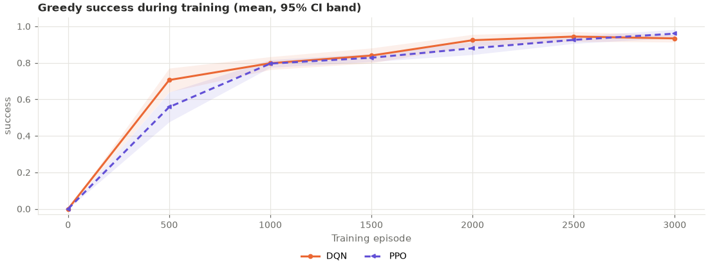
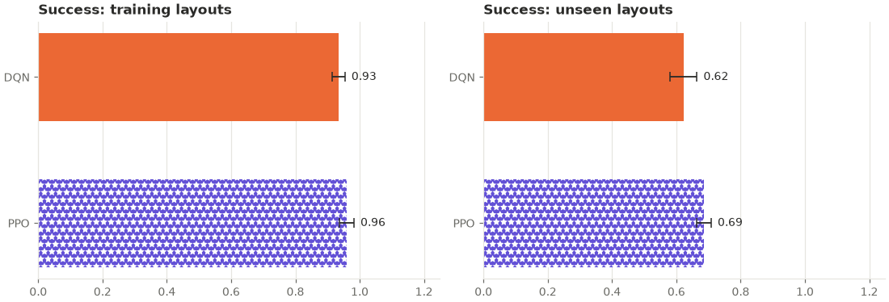

# ppo_replication: analysis

Protocol: [`PROTOCOL.md`](PROTOCOL.md), hypotheses H1–H2 (written before any run).
Analysis script: [`analyze.py`](analyze.py) (written before the run, run unchanged); its full
output is [`analysis_output.txt`](analysis_output.txt). Raw outputs: `results.csv` (final
greedy evaluation per seed and split), `curves.csv` (greedy evaluation on all 50 training
mazes every 500 episodes), `summary.csv`, `buffer_diagnostics.csv`, `secondary.json` (the
re-evaluations), `run.log`. The check run before it, that Stage I's DQN and PPO seed 700
still reproduce their saved logs exactly over 300 episodes: `pre_checks.py` and
`pre_checks_output.txt`. Trained networks: `models/` (see below).

## Answer

**Both Stage I results replicated.** With fresh seeds (1100–1109) and fresh mazes, PPO
again solved more held-out mazes than DQN (0.69 vs 0.62, ahead in 9 of 10 seeds) and again
learned its training mazes more slowly (learning speed 0.825 vs 0.858, behind in 8 of 10).
Both are significant after Holm correction (p = 0.021 each) and in the same direction as in
Stage I, so by the protocol's rule both are **replicated**.

| Hypothesis | DQN | PPO | Seeds ahead / tied / behind | p | Holm-adjusted p | Verdict |
|---|---|---|---|---|---|---|
| H1: held-out success | 0.62 ± 0.04 | 0.69 ± 0.02 | 9 / 0 / 1 | 0.010 | 0.021 | **Replicated: PPO better** |
| H2: learning speed | 0.858 ± 0.018 | 0.825 ± 0.020 | 2 / 0 / 8 | 0.015 | 0.021 | **Replicated: PPO slower** |

*Two-sided permutation tests on 10 vs 10 per-seed values, 200,000 resamples. "Ahead" means
PPO scored higher. Learning speed = greedy success on the 50 training mazes averaged over
the evaluations at 500, 1,000, …, 3,000 episodes.*

**Both studies together** (pre-specified descriptive summary, not a test): over the 20 seed
pairs of Stage I and this study, PPO minus DQN was **+0.058 ± 0.033** in held-out success
(Stage I +0.052, here +0.064) and **−0.052 ± 0.020** in learning speed (Stage I −0.070,
here −0.033). The held-out advantage is small, about 6 mazes in 100, but it has now appeared
in two independent studies.

## Results (greedy, mean ± 95% CI over seeds 1100–1109)

**Held-out mazes (layouts 10200–10250 except 10218, never seen in training)**

| Arm | Success | Path efficiency | Steps | Timeouts | Collisions | Revisits | Task reward |
|---|---|---|---|---|---|---|---|
| DQN | 0.62 ± 0.04 | 0.61 ± 0.04 | 46.4 ± 3.6 | 0.38 ± 0.04 | 7.9 ± 3.9 | 27.3 ± 4.5 | −0.82 ± 0.23 |
| PPO | 0.69 ± 0.02 | 0.66 ± 0.02 | 41.0 ± 1.9 | 0.31 ± 0.02 | 3.0 ± 2.1 | 25.6 ± 1.7 | −0.42 ± 0.14 |

**Training mazes (layouts 10100–10149)**

| Arm | Success | Path efficiency | Steps | Timeouts | Collisions | Revisits | Task reward |
|---|---|---|---|---|---|---|---|
| DQN | 0.93 ± 0.02 | 0.93 ± 0.02 | 20.5 ± 1.7 | 0.07 ± 0.02 | 0.7 ± 1.7 | 5.6 ± 2.4 | 0.57 ± 0.10 |
| PPO | 0.96 ± 0.02 | 0.93 ± 0.02 | 18.8 ± 1.9 | 0.04 ± 0.02 | 0.7 ± 0.9 | 2.9 ± 1.5 | 0.67 ± 0.11 |

**Held-out success per seed (1100–1109)**

| Arm | 1100 | 1101 | 1102 | 1103 | 1104 | 1105 | 1106 | 1107 | 1108 | 1109 |
|---|---|---|---|---|---|---|---|---|---|---|
| DQN | 0.68 | 0.66 | 0.68 | 0.54 | 0.58 | 0.54 | 0.64 | 0.62 | 0.70 | 0.58 |
| PPO | 0.70 | 0.68 | 0.70 | 0.74 | 0.68 | 0.64 | 0.72 | 0.68 | 0.68 | 0.64 |

**Greedy success on the 50 training mazes during training (mean over seeds)**

| Episode | 500 | 1000 | 1500 | 2000 | 2500 | 3000 |
|---|---|---|---|---|---|---|
| DQN | 0.71 | 0.80 | 0.84 | 0.92 | 0.94 | 0.93 |
| PPO | 0.56 | 0.80 | 0.83 | 0.88 | 0.93 | 0.96 |

## Secondary results (pre-specified, exploratory, no correction)

**Play with randomness.** Every final network played the held-out mazes 5 times (evaluation
seed 20,000 + run seed), after its greedy result had been re-checked against the saved one
(all 20 matched exactly).

| Mode | Held-out success |
|---|---|
| DQN, greedy | 0.62 |
| DQN, ε = 0.05 | 0.70 ± 0.03 |
| PPO, greedy | 0.69 |
| PPO, ε = 0.05 | 0.77 ± 0.02 |
| PPO, sampling its policy | 0.89 ± 0.01 |

- S1, PPO sampled vs DQN ε 0.05: 0.89 vs 0.70, ahead in all 10 seeds (p < 0.001). Same as
  Stage K's 0.90 vs 0.71 on the Stage I networks.
- S2, both with ε = 0.05: 0.77 vs 0.70, ahead in 9 seeds, tied in 1 (p = 0.0007). Stage K
  found 0.75 vs 0.71 (p = 0.025). With the same kind of randomness the gap is about the
  greedy one (+0.06), so, as in Stage K, most of PPO's large sampled margin comes from how it
  randomises its moves, not from a better network.

**Long vs short mazes.** Of the 50 held-out mazes, 22 have the minimum path length (12) and
28 are longer. PPO's advantage was again on the longer ones: 0.53 vs 0.44 (p = 0.018, ahead
in 7 seeds, tied in 3, behind in none), against 0.89 vs 0.85 on the short ones (p = 0.18).
In Stage I: 0.54 vs 0.43 on long mazes and level on short ones.

**Other measures.**
- **Where the learning-speed gap comes from.** PPO was behind at episode 500 (0.56 vs 0.71,
  p = 0.0065) and level from episode 1,000 on (all p ≥ 0.06); at the end it was slightly
  ahead (0.96 vs 0.93, p = 0.092). In Stage I PPO was behind at every evaluation up to
  2,500. So "slower" here means a slower start, and the gap was half Stage I's.
- **Held-out behaviour.** PPO took fewer steps (41.0 vs 46.4), timed out less (0.31 vs
  0.38) and hit walls less (3.0 vs 7.9 collisions per episode), all p ≤ 0.018, with higher
  path efficiency (0.66 vs 0.61, p = 0.019). Revisits did not differ (25.6 vs 27.3, p = 0.44).
- **Spread.** PPO's held-out success varied less across seeds (0.64–0.74) than DQN's
  (0.54–0.70).

## Interpretation

Stage I found, with one set of seeds and mazes, that PPO generalised slightly better and
learned more slowly. Both held with new seeds and new mazes, with similar sizes and the same
pattern: the held-out gain is on longer mazes, where DQN times out more. The held-out
difference is small (about +0.06) but it is now consistent across two pre-registered
studies and 20 seed pairs, so it can be stated without the earlier "needs replicating".

What this does **not** show:
1. **Why.** PPO hits walls far less on new mazes and times out less, but nothing here
   separates the possible reasons (learning a policy instead of values, learning only from
   fresh experience, its entropy bonus, or its different settings).
2. **Tuned comparisons.** Both algorithms use standard settings fixed in advance; tuned
   versions might rank differently.
3. **That the size of the learning-speed gap is stable.** It halved between the studies
   (−0.070 vs −0.033); only its direction replicated.

Plain DQN reached 0.62 on held-out mazes here, against 0.64 in Stage I and 0.29–0.70 in
the other studies. As before, only comparisons within one study are meaningful.

## Trained networks (`models/`)

`models/<arm>_s<seed>.pt` holds each run's final network: the run's config and the trained
network only, without the replay buffer, target network, optimizer state or PPO's
half-collected rollout (`training.export_weights`; 3.3 MB in all). Load one with `load_agent` or the
dashboard's Checkpoints tab to evaluate it or watch it play; they cannot resume training.
Each file was checked after export: it reproduces its run's saved training and held-out
results exactly (success, steps, reward, revisits and collisions on all 100 mazes). The full
checkpoints were kept outside the repository.

## Compute

Mean environment steps per run: 113,837 (DQN) and 85,563 (PPO). With two runs in parallel a
DQN run took about 5.5 minutes and a PPO run about 1.5–2 minutes, except PPO seed 1109,
which took 20 minutes. Its training was no different from the other PPO runs (the same
steps per episode and success in every 500-episode block as seed 1108), and the run was not
interrupted, so the delay came from the laptop, not the algorithm; its cause was not found.
The whole experiment ran from 20:37 to 21:32, 55 minutes, within the protocol's estimate.

## Deviations from the protocol

- **`run.log` was regenerated.** The console output was appended in UTF-16. After all 20
  runs had finished, the same command was run once more: it only reloads the finished runs
  and reprints the log. `results.csv`, `curves.csv`, `summary.csv`, `buffer_diagnostics.csv`
  and `experiment.json` were byte-identical before and after.
- Otherwise none. The run was not interrupted, and the analysis script was written before
  the results existed and was run unchanged (two cosmetic formatting fixes to its printing
  of per-seed lists were made during its smoke test, before the run).
