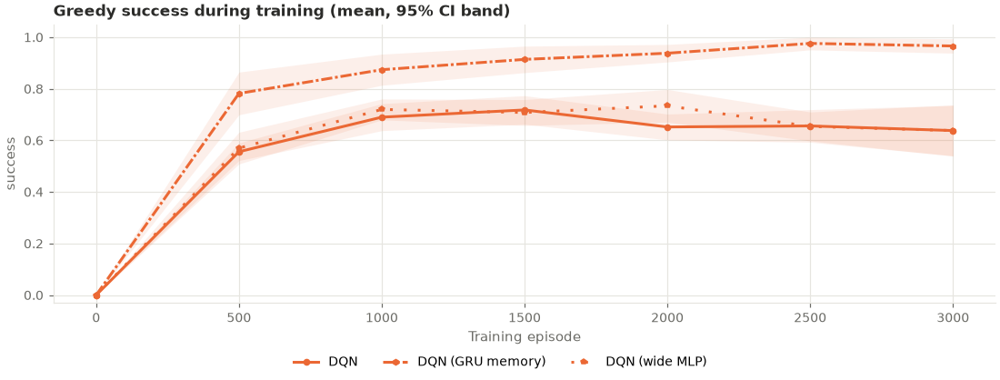
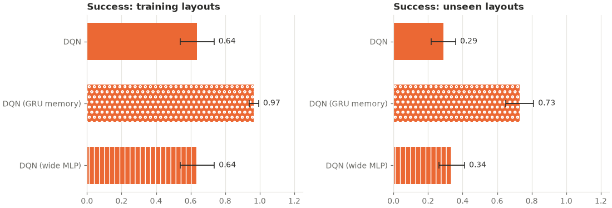

# rnn_generalization: analysis

Protocol: [`PROTOCOL.md`](PROTOCOL.md), hypotheses H1–H3 (written before any run).
Raw outputs: `results.csv` (final greedy evaluation per seed and split), `curves.csv`
(greedy evaluation on all 50 training mazes every 500 episodes), `summary.csv`,
`buffer_diagnostics.csv`, `run.log`. Trained networks: `models/` (see below).

## Answer

**Memory helped, by a wide margin.** On the 50 held-out mazes the DQN with a GRU memory
reached the goal in 0.73 of them against 0.29 for the standard DQN, ahead in all 10
seeds (Holm-adjusted p = 0.0004). It also revisited cells less than half as often per
episode (20.1 against 44.1, lower in all 10 seeds, Holm-adjusted p = 0.0004). This is
the first change tested in this project (Stages C–H) to improve success on mazes the
agent has never seen.

**Stage E's wide-MLP result did not replicate.** With fresh seeds and mazes, the
288 × 288 MLP reached 0.34 against 0.29 for the standard MLP (Holm-adjusted p = 0.32).
By the protocol's rule this is reported as not replicated.

| Hypothesis | DQN (MLP) | Other arm | Seeds ahead / tied / behind | p | Holm-adjusted p | Verdict |
|---|---|---|---|---|---|---|
| H1: held-out success, GRU vs MLP | 0.29 ± 0.07 | 0.73 ± 0.08 | 10 / 0 / 0 | 0.0001 | 0.0004 | **Memory helps** |
| H2: held-out revisits per episode, GRU vs MLP | 44.1 ± 3.9 | 20.1 ± 6.4 | 10 / 0 / 0 fewer | 0.0002 | 0.0004 | **Memory helps** (read with H1, see below) |
| H3: held-out success, wide MLP vs MLP | 0.29 ± 0.07 | 0.34 ± 0.07 | 7 / 1 / 2 | 0.32 | 0.32 | No evidence of a difference: **not replicated** |

*"Ahead" means the second arm scored better (higher success, fewer revisits).
Permutation tests on 10 per-seed values, 20,000 resamples.*

**Is it the memory or the size?** The protocol attributes a significant H1 to memory
only if the GRU network also beats the wide MLP, which has about as many weights. It
does: 0.73 against 0.34 on held-out mazes (exploratory, p = 0.0001, ahead in 10 of 10
seeds). So the gain is not a matter of network size. It is not yet separated from the
recurrent arm's different replay, though (see "Interpretation").

**How to read H2.** Revisits per episode fall partly because a solved maze ends early.
The pre-registered check, revisits per step, is also lower with memory (0.49 against
0.60), but only modestly: p = 0.048 (exploratory, uncorrected), lower in 7 of 10 seeds.
So most of the drop in revisits comes from solving more mazes and finishing sooner, not
from looping less often per step. The two are related: an agent that stops looping
reaches the goal.

## Results (greedy, mean ± 95% CI over seeds 600–609)

**Held-out mazes (layouts 9600–9651 except 9619 and 9632, never seen in training)**

| Arm | Success | Path efficiency | Steps | Timeouts | Collisions | Revisits | Revisits per step | Task reward |
|---|---|---|---|---|---|---|---|---|
| DQN (MLP 128 × 128) | 0.29 ± 0.07 | 0.29 ± 0.07 | 75.0 ± 6.0 | 0.71 ± 0.07 | 23.4 ± 8.4 | 44.1 ± 3.9 | 0.60 ± 0.07 | −2.58 ± 0.51 |
| DQN (GRU memory) | 0.73 ± 0.08 | 0.68 ± 0.08 | 39.7 ± 6.5 | 0.27 ± 0.08 | 5.5 ± 2.4 | 20.1 ± 6.4 | 0.49 ± 0.09 | −0.37 ± 0.35 |
| DQN (wide MLP 288 × 288) | 0.34 ± 0.07 | 0.34 ± 0.07 | 70.9 ± 6.4 | 0.66 ± 0.07 | 23.5 ± 3.7 | 38.9 ± 8.5 | 0.54 ± 0.07 | −2.39 ± 0.30 |

**Training mazes (layouts 9500–9549)**

| Arm | Success | Path efficiency | Steps | Timeouts | Collisions | Revisits | Revisits per step | Task reward |
|---|---|---|---|---|---|---|---|---|
| DQN (MLP 128 × 128) | 0.64 ± 0.10 | 0.63 ± 0.10 | 45.7 ± 8.3 | 0.36 ± 0.10 | 7.5 ± 5.2 | 27.3 ± 6.3 | 0.59 ± 0.08 | −0.78 ± 0.51 |
| DQN (GRU memory) | 0.97 ± 0.03 | 0.95 ± 0.04 | 19.4 ± 2.4 | 0.03 ± 0.03 | 1.5 ± 1.8 | 1.9 ± 2.0 | 0.09 ± 0.08 | 0.65 ± 0.15 |
| DQN (wide MLP 288 × 288) | 0.64 ± 0.10 | 0.63 ± 0.10 | 45.7 ± 8.4 | 0.36 ± 0.10 | 9.7 ± 3.9 | 24.5 ± 9.5 | 0.51 ± 0.11 | −0.83 ± 0.42 |

**Held-out success per seed (600–609)**

| Arm | 600 | 601 | 602 | 603 | 604 | 605 | 606 | 607 | 608 | 609 |
|---|---|---|---|---|---|---|---|---|---|---|
| DQN (MLP) | 0.14 | 0.26 | 0.32 | 0.42 | 0.26 | 0.12 | 0.38 | 0.34 | 0.36 | 0.30 |
| DQN (GRU memory) | 0.70 | 0.88 | 0.68 | 0.76 | 0.74 | 0.48 | 0.70 | 0.84 | 0.84 | 0.68 |
| DQN (wide MLP) | 0.30 | 0.36 | 0.10 | 0.36 | 0.30 | 0.30 | 0.42 | 0.34 | 0.48 | 0.42 |

The worst GRU seed (605, 0.48) beat the best MLP seed (603, 0.42).

**Greedy success on the 50 training mazes during training (mean over seeds)**

| Episode | 500 | 1000 | 1500 | 2000 | 2500 | 3000 |
|---|---|---|---|---|---|---|
| DQN (MLP) | 0.56 | 0.69 | 0.72 | 0.65 | 0.66 | 0.64 |
| DQN (GRU memory) | 0.78 | 0.87 | 0.91 | 0.94 | 0.98 | 0.97 |
| DQN (wide MLP) | 0.57 | 0.72 | 0.71 | 0.73 | 0.65 | 0.64 |

## Exploratory results (not pre-registered as primary; no correction)

- **GRU vs wide MLP (same size)**: ahead on held-out success (0.73 vs 0.34, p = 0.0001,
  10/10 seeds) and fewer held-out revisits (20.1 vs 38.9, p = 0.0005, 10/10). Revisits
  per step were not significantly different (0.49 vs 0.54, p = 0.30).
- **Learning speed** (training-maze success averaged over the 6 evaluations): GRU 0.908
  against 0.652 for the MLP (p = 0.0001, 10/10 seeds) and 0.671 for the wide MLP
  (p = 0.0001). The GRU was ahead at every evaluation (+0.18 to +0.33, p ≤ 0.0003). Wide
  MLP vs MLP: 0.671 vs 0.652 (p = 0.35); significant at one of the six points only
  (episode 2000, +0.08, p = 0.04).
- **Training mazes**: the GRU network solved 0.97 of them (MLP 0.64, p = 0.0001), with
  path efficiency 0.95 vs 0.63 (p = 0.0001), and almost stopped revisiting cells
  (1.9 vs 27.3 per episode, p = 0.0001).
- **Held-out, other metrics**: with memory, fewer steps (39.7 vs 75.0), fewer timeouts
  (0.27 vs 0.71) and fewer collisions (5.5 vs 23.4), all p = 0.0001. The wide MLP differed
  from the MLP on none of these (p ≥ 0.24).
- **Steps to the goal in solved episodes** are higher with memory (held-out 17.3 vs 13.7).
  This is not worse navigation: the GRU network solves many long mazes the MLP never
  solves, so its successful episodes are on average longer mazes.
- **By maze difficulty** (held-out success re-evaluated from each run's final
  checkpoint, which reproduces the saved results exactly): on the 19 held-out mazes with
  the minimum path length (12), GRU 0.88 and wide MLP 0.57 against 0.51 for the MLP
  (p = 0.0001 and 0.55); on the 31 longer ones, 0.64 and 0.19 against 0.16
  (p = 0.0001 and 0.33). Memory helped most on the longer mazes, where the MLP almost
  always failed.
- **Compute**: mean environment steps per run were 143,000 (MLP), 123,000 (GRU; fewer
  because its episodes end sooner) and 143,000 (wide MLP). An MLP run took about 9
  minutes of wall-clock time with two runs in parallel. A GRU run took roughly 1 to 2
  hours (1 hour on 2026-11-04, about 2 hours on 2026-11-03 on the same laptop; the
  script's per-run times are not reliable for this arm because runs were resumed, see
  "Deviations"), so about 7–13× the cost of an MLP run.

## Interpretation

With a 5×5 view the agent cannot tell from one observation whether it has been in a
place before, and on new mazes the standard DQN mostly failed by wandering until it
timed out (0.71 of held-out episodes). Giving it a memory that lasts through the
episode roughly halved the timeouts and raised held-out success from 0.29 to 0.73. The
same network also learned the training mazes almost perfectly, which no earlier arm
did. Four earlier changes (shaping, 3-step returns, a curriculum, a CNN) did not
improve held-out success; this is the first that did.

What the study does **not** separate:

1. **Memory vs the recurrent arm's replay.** The GRU arm learns from runs of 16
   consecutive steps (32 runs per update, so up to 512 trained steps per update against
   64 for the MLPs), with burn-in. Updates happen equally often in all arms, so each
   update of the GRU arm trains on up to 8 times as many steps. The wide MLP rules out
   network size as the explanation, but not this. A follow-up could give an MLP the same
   number of trained steps per update (batch 512), or give the GRU arm its memory
   cleared at every step.
2. **What the memory stores.** Nothing here shows that the network remembers visited
   cells, as opposed to, say, how long it has been going in one direction. Revisits per
   step fell only modestly (0.49 vs 0.60, p = 0.048, exploratory), so the gain is not
   simply "it stopped looping".
3. **No tuning.** Sequence length, burn-in and network sizes were fixed in advance. The
   result might be larger or smaller with other settings.

The wide-MLP result from Stage E (held-out 0.47 vs 0.33, exploratory) was not
replicated here (0.34 vs 0.29, p = 0.32), so it should not be claimed. This is the
reason exploratory results were kept as exploratory.

Plain DQN's held-out success here (0.29) is close to Stage E's (0.33) and lower than
Stage H's (0.57). As before, only comparisons within one study, on the same mazes and
seeds, are meaningful.

## Trained networks (`models/`)

`models/<arm>_s<seed>.pt` holds each run's final network: the run's config and the
trained (online) network only, without the replay buffer, target network or optimizer
state (`training.export_weights`; 0.11 MB per MLP, 0.44 MB per GRU or wide MLP, 9.9 MB in
all). Load one with `load_agent` or the dashboard's Checkpoints tab to evaluate it or
watch it play. They cannot resume training. Each file was checked after export: it
reproduces its run's saved training and held-out results exactly (success, steps,
reward, revisits and collisions on all 100 mazes). The full checkpoints (about 15 MB
each) were kept outside the repository.

## Replay buffer

From `buffer_diagnostics.csv`: runs added about 143,000 (MLP), 123,000 (GRU) and
143,000 (wide MLP) transitions; every 20,000-transition buffer overwrote most of them.

## Deviations from the protocol

- **The run was stopped and resumed three times.** As the protocol requires, every
  stop was resumed with the same command, never restarted, always with `--workers 2`,
  and in a PowerShell window outside Claude Code. Resumed runs continue from their last
  checkpoint (every 500 episodes) and reproduce an uninterrupted run exactly (tested);
  any episodes after the last checkpoint are played again.
  1. 2026-11-01, about 8 minutes after launch: the window running it was closed by
     mistake and the process was ended. No run had finished (plain DQN seeds 600 and
     601 were about 350 episodes in).
  2. 2026-11-03, 14:27: stopped to move the project from drive C (nearly full) to
     drive D. By then all 10 plain-DQN runs had finished; GRU seeds 600 and 601 were at
     episode 500. On D the virtual environment was rebuilt from the same package list
     (Python 3.11.9, torch 2.14.1+cpu) and the full test suite passed, including the
     exact-resume test, before the run was resumed at 15:27. Bit-identical behaviour
     across the two installations was not checked separately for these runs.
  3. 2026-11-03, 22:51 to 2026-11-04, 16:59: paused overnight. GRU seeds 600–605 had
     finished; seed 606 had finished training but not its final evaluation, which was
     redone on resume; seed 607 continued from episode 2000.
- **The time estimate was wrong.** The protocol expected about 6 hours in all. The GRU
  runs took 1–2 hours each with two in parallel (the timing check measured one process
  on 200 episodes; why it underestimated was not investigated), so the experiment took
  about 11 hours of running time. Nothing about the runs was changed
  because of this.
- **`run.log` was regenerated.** The console output had been appended over several
  sessions in UTF-16. After all 30 runs had finished, the same command was run once more:
  it only reloads the finished runs and reprints the log. `results.csv`, `curves.csv`,
  `summary.csv`, `buffer_diagnostics.csv` and `experiment.json` were byte-identical
  before and after.
- Otherwise none. The analysis script was written before the results existed and was
  run unchanged.
