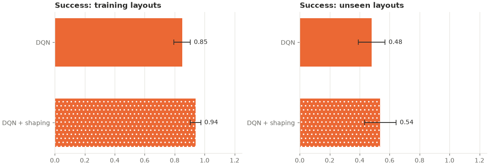

# shaping_generalization: analysis

Protocol: [`../shaping_speed/PROTOCOL.md`](../shaping_speed/PROTOCOL.md), hypothesis H3
(written before any run). Raw outputs: `results.csv` (final greedy evaluation per seed and
split), `curves.csv` (greedy evaluation on the training mazes every 500 episodes),
`summary.csv`, `buffer_diagnostics.csv`, `run.log`.

## Answer

**No evidence that reward shaping helps DQN on mazes it has never seen.** On the 50
held-out mazes, shaped DQN reached the goal in 54% against 48% for plain DQN. The
difference is not significant (p = 0.366), so by the pre-registered rule the result is
"no evidence of a difference".

| Hypothesis | DQN | DQN + shaping | Seeds ahead / tied / behind | p |
|---|---|---|---|---|
| H3: held-out success | 0.48 ± 0.09 | 0.54 ± 0.11 | 6 / 1 / 3 | 0.366 |

## Results (greedy, mean ± 95% CI over seeds 200-209)

**Held-out mazes (layouts 7200-7249, never seen in training)**

| Arm | Success | Path efficiency | Steps | Collisions | Revisits | Task reward |
|---|---|---|---|---|---|---|
| DQN | 0.48 ± 0.09 | 0.48 ± 0.09 | 58.3 ± 7.7 | 14.2 ± 8.4 | 34.2 ± 9.2 | −1.55 ± 0.50 |
| DQN + shaping | 0.54 ± 0.11 | 0.53 ± 0.10 | 53.6 ± 9.1 | 3.0 ± 1.9 | 39.8 ± 10.1 | −0.99 ± 0.42 |

**Training mazes (layouts 7100-7149)**

| Arm | Success | Path efficiency | Steps | Collisions | Revisits | Task reward |
|---|---|---|---|---|---|---|
| DQN | 0.85 ± 0.05 | 0.85 ± 0.06 | 27.1 ± 4.5 | 3.4 ± 3.1 | 10.8 ± 4.4 | 0.18 ± 0.27 |
| DQN + shaping | 0.94 ± 0.03 | 0.94 ± 0.04 | 19.8 ± 2.9 | 0.4 ± 0.5 | 5.2 ± 3.3 | 0.61 ± 0.13 |

**Held-out success per seed (200-209)**

| Arm | Seeds 200-209 |
|---|---|
| DQN | 0.62, 0.46, 0.32, 0.36, 0.52, 0.66, 0.60, 0.46, 0.50, 0.30 |
| DQN + shaping | 0.72, 0.62, 0.28, 0.30, 0.58, 0.66, 0.48, 0.64, 0.60, 0.50 |

## Exploratory results (not pre-registered as primary; no correction)

- **Training mazes: shaping helped.** Final success 0.94 vs 0.85 (p = 0.005, ahead in all
  10 seeds). Learning speed (mean greedy success over the six evaluations, episodes
  500-3,000) 0.914 vs 0.816 (p < 0.001, ahead in all 10 seeds). Path efficiency 0.94 vs
  0.85 (p = 0.005). This agrees with `shaping_speed`.
- **Held-out mazes: far fewer wall collisions** (3.0 vs 14.2 per episode, p = 0.004), and a
  higher task reward that is not significant (−0.99 vs −1.55, p = 0.070). Revisits were
  slightly higher with shaping (39.8 vs 34.2, p = 0.35). On new mazes the shaped agent
  stopped walking into walls but did not get lost less often.
- **Steps to goal** (successful episodes only) were longer with shaping, by 0.5 steps on
  training mazes and 0.8 on held-out ones (both p < 0.001). This average covers only the
  mazes each arm solved, and the shaped arm solved more of them, so it can't be read as
  shaped agents taking longer routes.
- Greedy training success during training, mean over seeds:

  | Episode | 500 | 1,000 | 1,500 | 2,000 | 2,500 | 3,000 |
  |---|---|---|---|---|---|---|
  | DQN | 0.73 | 0.81 | 0.80 | 0.85 | 0.84 | 0.85 |
  | DQN + shaping | 0.84 | 0.90 | 0.90 | 0.94 | 0.96 | 0.94 |

## Interpretation

Shaping made DQN learn its 50 training mazes faster and end up better on them, but the
gain on mazes it had never seen was small (+0.06) and not distinguishable from seed noise
with 10 seeds. One plausible reason, not tested here: with a 5x5 local view the agent can
see the walls around it but not the maze distance the hint is based on, so what it learns
from the hint is partly tied to the specific training mazes. A larger study (more seeds,
or more held-out mazes per seed) would be needed to detect an effect of +0.06, if there
is one.

## Replay buffer

From `buffer_diagnostics.csv`: plain DQN runs added 119,780 transitions on average and
shaped runs 105,753 (shaped episodes were shorter); both main buffers (20,000) overwrote
most of what they saw.

## Deviations from the protocol

None. 20 runs, `--workers 4`, 63 minutes. The background job reported exit code 1 because
of a `tail` command after the experiment had finished; the experiment completed normally
(see `run.log`).

## Post-hoc note (2026-10-30): one held-out maze was also a training maze

Found while preparing the curriculum study, after these results were written: held-out
layout 7223 generates exactly the same maze as training layout 7147 (a 9×9 maze has only
a 4×4 grid of rooms, so two seeds can produce the same maze). The held-out set was
therefore 49 unseen mazes plus one training maze. Both arms were tested on the same
mazes, so the comparison stays fair. Re-evaluating every run's final checkpoint (which
reproduces the saved results exactly) without layout 7223:

| | Shaped DQN | DQN | p |
|---|---|---|---|
| All 50 held-out layouts (as reported) | 0.538 | 0.480 | 0.366 |
| 49 genuinely unseen layouts | 0.529 | 0.469 | 0.366 |

Both arms solved the duplicate maze in 10/10 runs. The conclusion (no evidence of a
difference on unseen mazes) is unchanged. Later studies check that no held-out maze
duplicates a training maze.
