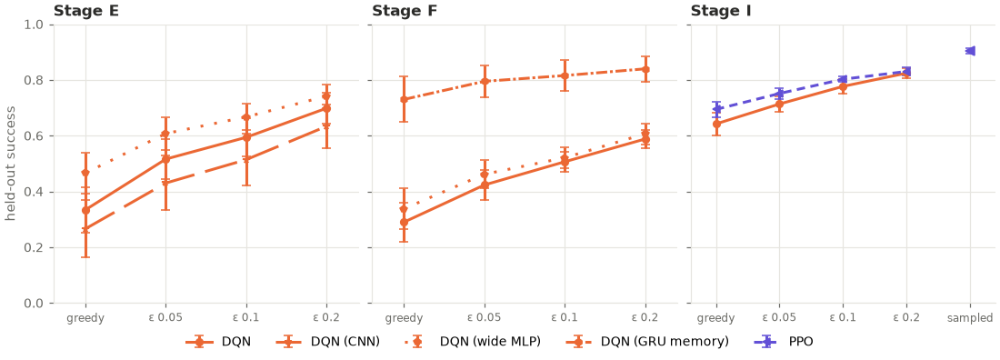

# stochastic_evaluation: analysis

Protocol: [`PROTOCOL.md`](PROTOCOL.md), hypotheses H1–H3 (written before any stochastic
evaluation). Analysis script: [`analyze.py`](analyze.py) (written before the run,
unchanged), its full output: [`analysis_output.txt`](analysis_output.txt). Raw outputs:
`results.csv` (one row per network and mode: mean held-out metrics), `episodes.csv.gz`
(every episode: 80 networks, 66,500 episodes), `run.log`. No training: the 80 networks
are the saved ones in `results/{cnn,rnn,ppo}_generalization/models/`.

## Answer

**A little randomness at test time raised held-out success for every one of the 80
networks, and the memory and PPO advantages survive it.** All three pre-registered
hypotheses are supported after Holm correction:

| Hypothesis | Compared | Means | Networks higher / tied / lower | p | Holm-adjusted p | Verdict |
|---|---|---|---|---|---|---|
| H1: randomness for plain DQN (paired, 30 networks) | ε 0.05 vs greedy | 0.55 vs 0.42 (difference +0.13 ± 0.02) | 30 / 0 / 0 | < 0.001 | < 0.001 | **ε 0.05 better** |
| H2: Stage I, each with its own randomness | PPO sampled vs DQN ε 0.05 | 0.90 ± 0.01 vs 0.71 ± 0.03 | every PPO seed above every DQN seed | < 0.001 | < 0.001 | **PPO better** |
| H3: Stage F, memory under randomness | GRU ε 0.05 vs MLP ε 0.05 | 0.80 ± 0.06 vs 0.42 ± 0.05 | every GRU seed above every MLP seed | < 0.001 | < 0.001 | **GRU better** |

*Held-out success, mean ± 95% CI over seeds. H1: sign-flip permutation test on the 30
paired differences (200,000 Monte Carlo resamples, p ≈ 5 × 10⁻⁶). H2, H3: exact
permutation test on 10 vs 10 per-seed values (p = 2 / 184,756 ≈ 1 × 10⁻⁵, the smallest
possible). The Holm-adjusted p-values are below 0.001 for all three.*

- **H1.** With ε = 0.05 (one random move in twenty, the rate DQN ended training with),
  plain DQN solved 0.13 more of the held-out mazes than greedily, and every one of the 30
  networks improved (smallest gain +0.03). The gain appears in every study: +0.18
  (Stage E), +0.13 (F), +0.07 (I), with every network improving in each.
- **H2.** With both allowed their own kind of randomness, PPO (sampled) still solved
  far more held-out mazes than DQN (ε 0.05): 0.90 against 0.71, with no overlap
  between seeds (PPO 0.88–0.92, DQN 0.65–0.76). As the protocol notes, PPO's side was
  not a blind measurement (Stage I had already measured 0.90 with other seeds).
- **H3.** The Stage F memory result holds when both networks play with ε = 0.05: the
  GRU solved 0.80 of the held-out mazes against 0.42 for the MLP (0.73 vs 0.29
  greedily). The gap narrows slightly (+0.37 instead of +0.44) but there is still no
  overlap between seeds (GRU 0.61–0.91, MLP 0.27–0.55).

## Results (held-out success, mean ± 95% CI over 10 seeds per arm)

| Study | Arm | Greedy | ε 0.05 | ε 0.1 | ε 0.2 | Sampled |
|---|---|---|---|---|---|---|
| E | DQN | 0.33 ± 0.08 | 0.52 ± 0.07 | 0.59 ± 0.07 | 0.70 ± 0.06 | — |
| E | DQN (CNN) | 0.27 ± 0.10 | 0.43 ± 0.10 | 0.51 ± 0.09 | 0.63 ± 0.08 | — |
| E | DQN (wide MLP) | 0.47 ± 0.07 | 0.61 ± 0.06 | 0.67 ± 0.05 | 0.74 ± 0.04 | — |
| F | DQN | 0.29 ± 0.07 | 0.42 ± 0.05 | 0.51 ± 0.04 | 0.59 ± 0.03 | — |
| F | DQN (GRU memory) | 0.73 ± 0.08 | 0.80 ± 0.06 | 0.82 ± 0.06 | 0.84 ± 0.05 | — |
| F | DQN (wide MLP) | 0.34 ± 0.07 | 0.46 ± 0.05 | 0.52 ± 0.04 | 0.61 ± 0.04 | — |
| I | DQN | 0.64 ± 0.04 | 0.71 ± 0.03 | 0.78 ± 0.03 | 0.82 ± 0.02 | — |
| I | PPO | 0.69 ± 0.03 | 0.75 ± 0.02 | 0.80 ± 0.01 | 0.83 ± 0.01 | 0.90 ± 0.01 |

Greedy values reproduce each study's saved held-out results exactly (checked for every
network on success, steps, reward, collisions, revisits and timeouts). Stochastic modes:
5 passes over the 50 held-out mazes per network.

**Per seed, the hypotheses' values**

| Arm (mode) | s0 | s1 | s2 | s3 | s4 | s5 | s6 | s7 | s8 | s9 |
|---|---|---|---|---|---|---|---|---|---|---|
| E DQN greedy | 0.24 | 0.42 | 0.34 | 0.54 | 0.38 | 0.46 | 0.28 | 0.28 | 0.18 | 0.22 |
| E DQN ε 0.05 | 0.50 | 0.60 | 0.46 | 0.70 | 0.55 | 0.63 | 0.49 | 0.46 | 0.38 | 0.42 |
| F DQN greedy | 0.14 | 0.26 | 0.32 | 0.42 | 0.26 | 0.12 | 0.38 | 0.34 | 0.36 | 0.30 |
| F DQN ε 0.05 | 0.40 | 0.37 | 0.44 | 0.55 | 0.40 | 0.27 | 0.44 | 0.41 | 0.51 | 0.44 |
| F GRU ε 0.05 | 0.77 | 0.91 | 0.78 | 0.83 | 0.79 | 0.61 | 0.78 | 0.85 | 0.86 | 0.76 |
| I DQN greedy | 0.62 | 0.68 | 0.64 | 0.54 | 0.72 | 0.64 | 0.66 | 0.56 | 0.66 | 0.70 |
| I DQN ε 0.05 | 0.67 | 0.71 | 0.72 | 0.68 | 0.75 | 0.70 | 0.75 | 0.65 | 0.73 | 0.76 |
| I PPO sampled | 0.88 | 0.91 | 0.90 | 0.90 | 0.88 | 0.90 | 0.92 | 0.92 | 0.91 | 0.90 |

*s0–s9 are seeds 500–509 (E), 600–609 (F) and 700–709 (I).*

## Exploratory results (uncorrected, not pre-registered tests)

- **Every arm gains from randomness, at every ε tried.** Each of the 8 arms improved
  over greedy at ε 0.05, 0.1 and 0.2 on all 10 of its networks (paired p = 0.002, the
  smallest possible with 10 pairs, for all 25 comparisons). Success still rose between
  ε 0.1 and 0.2 for every arm, so the best ε is above the range tested; this study does
  not say what it is.
- **Arms that loop more gain more.** Plain MLPs gained +0.12 to +0.18 at ε 0.05; the GRU
  (+0.07) and PPO (+0.06), which already looped less, gained least. At ε 0.2 the GRU's
  path efficiency fell (0.68 → 0.60), and so did Stage I's (DQN 0.64 → 0.60, PPO
  0.68 → 0.61): for agents that rarely loop, random moves begin to cost steps.
- **Randomness rescues failures and almost never breaks a success.** On the mazes a
  network solved greedily, it still solved 99–100% of the ε 0.05 episodes; on the mazes
  it timed out on greedily, it now solved 18–28%. Timeouts fell in every arm (e.g.
  Stage E DQN 0.67 → 0.48), as did revisits.
- **Sampling suits PPO better than ε.** PPO with ε 0.05 reached 0.75 and with ε 0.2
  0.83, but sampling its own policy reached 0.90 with fewer steps (27 vs 39), fewer
  collisions (2.7 vs 5.1) and fewer revisits (9.5 vs 20.3) than ε 0.05. Its own
  probabilities place randomness where it is uncertain; ε spreads it evenly.
- **Earlier between-arm comparisons, greedy vs ε 0.05.** None changes direction:
  - Stage E CNN vs MLP: 0.27 vs 0.33 greedy (p = 0.27), 0.43 vs 0.52 at ε 0.05
    (p = 0.13). Still no evidence of a difference.
  - Stage E wide vs MLP: 0.47 vs 0.33 (p = 0.018), 0.61 vs 0.52 (p = 0.041).
    Stage F wide vs MLP: 0.34 vs 0.29 (p = 0.32), 0.46 vs 0.42 (p = 0.27). The Stage E
    hint is still not replicated in Stage F.
  - Stage I PPO vs DQN, both greedy: 0.69 vs 0.64 (p = 0.035); both ε 0.05: 0.75 vs
    0.71 (p = 0.025). With the *same* kind of randomness, PPO's edge stays small; most of
    the H2 gap comes from sampling, not from PPO's networks being better at the same
    kind of play.
- **Short vs long mazes.** At ε 0.05 the gains came on both: e.g. Stage E DQN 0.44 →
  0.64 on mazes with a shortest path of 12 and 0.19 → 0.35 on longer ones. PPO sampled
  reached 0.87 on the longer mazes (greedy 0.54).
- **Repeat-to-repeat spread.** The success of one network differed between its 5 passes
  by a standard deviation of 0.02–0.04, much smaller than the differences between
  networks, so 5 passes were enough.

## Interpretation

1. **Greedy evaluation understated every agent, and the agents with a local view most.**
   A deterministic policy that sees the same 5×5 window twice repeats the same move and
   can loop until the 100-step limit. A random move now and then breaks the loop. All
   earlier held-out numbers in this project are greedy and should be read as a lower
   bound on what those networks can do on new mazes, not as their capability.
2. **The earlier conclusions stand.** The memory result (Stage F) and PPO's edge over DQN
   (Stage I) both hold under randomness, and no earlier "no evidence" result turned into
   a difference. The memory gap shrank only a little (+0.44 → +0.37): the GRU does not
   just loop less; it solves more mazes even when loops are broken for both.
3. **Why PPO's sampled play wins by so much.** PPO's network is only slightly better than
   DQN's when both get the same kind of randomness (ε 0.05: +0.04). The big gap in H2
   comes from *how* the randomness is used: sampling the policy puts random choices
   where the network is unsure. That is a property of a policy-based agent, so H2 is a
   fair comparison of "each agent played the way it was trained", not of the networks
   alone.
4. **ε-greedy at test time is not free.** At larger ε, agents that rarely loop take
   longer paths. With a fixed ε, the right amount of randomness depends on the agent,
   and this study only tested 0.05–0.2.

## Limitations

- Only held-out success was a primary outcome; all other metrics are exploratory.
- Evaluation randomness is a fix applied after training; it says nothing about whether
  training with more exploration, or a memory, would be better.
- The 30 networks in H1 come from three studies with different held-out mazes; the
  test is paired within each network, and the effect appears in every study separately.
- PPO's side of H2 had been measured before (Stage I, 0.90 with other evaluation seeds).

## Deviations from the protocol

None. The run took 13 minutes with two workers (the protocol expected under an hour),
with no interruptions. The analysis script ran unchanged. The chart hides the
"sampled" column in the two panels without a PPO arm (drawing only).
